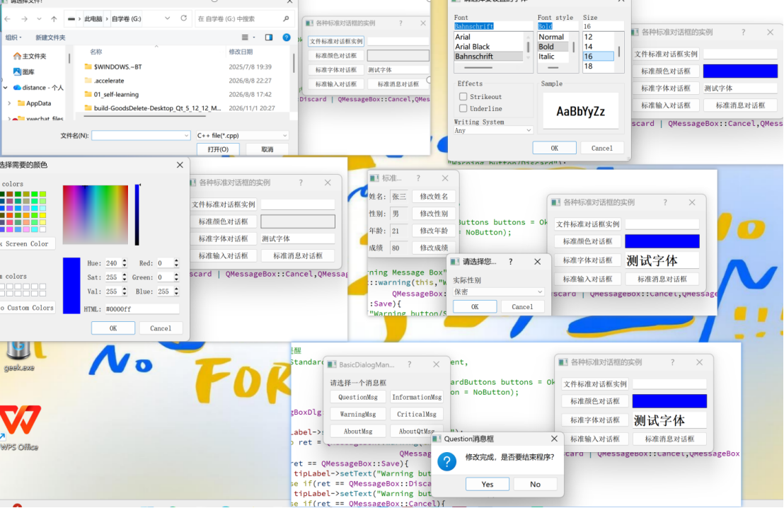

# 📌 交互的灵魂：Qt 标准对话框 (Standard Dialogs) 开发实战手册



**📂 项目路径**：`QT/BasicDialogManager`

**🎯 项目背景：**
桌面软件的灵魂在于交互。本项目不仅实操了 Qt 提供的文件、颜色、字体、输入和消息提示框，还深入探讨了企业级开发中常见的模态/非模态管理、自定义 UI 改造、以及内存泄漏防范。

---

## 🛠️ 一、基础标准对话框实战

### 1. 文件选择 (`QFileDialog`)
在读取配置文件、导入数据、选择保存路径时最常用。
- **核心 API**：`getOpenFileName` (打开)、`getSaveFileName` (保存)、`getExistingDirectory` (选文件夹)。
- **过滤器技巧**：使用 `"文本文件(*.txt);;图片文件(*.png *.jpg);;所有文件(*.*)"`。注意：**双分号 `;;`** 用于分隔不同的类别。
- **⚠️ 实战避坑（中文乱码）**：在 Windows 下，直接使用 Qt 获取的文件路径，如果遇到中文路径，底层可能会产生乱码。推荐在获取到路径后，使用 `QFile::encodeName()` 或确保工程编码为 UTF-8。

### 2. 颜色选择 (`QColorDialog`)
- **核心 API**：`getColor(initialColor, parent, title, options)`。
- **实战扩展**：`options` 参数极其重要。
  - `QColorDialog::ShowAlphaChannel`：允许用户选择透明度（在做绘图软件时必用）。
  - `QColorDialog::DontUseNativeDialog`：强制不使用系统自带的颜色框（因为 Windows 和 Mac 的框长得不一样，为了保证跨平台 UI 统一，通常强制使用 Qt 自己画的框）。
- **⚠️ 避坑**：用户点“取消”会返回无效颜色，**必须**用 `color.isValid()` 判断。

### 3. 字体选择 (`QFontDialog`)
- **核心 API**：`getFont(&ok, initialFont)`。
- **实战扩展**：`QFont` 对象不仅包含字体名字和大小，还包含**加粗、倾斜、下划线、删除线**。可以通过 `QFont::Bold` 等枚举值精确控制。`ok` 指针用来判断用户是否真正点击了“确认”。

### 4. 标准输入 (`QInputDialog`)
不用自己从零手写一个输入表单，一行代码搞定简单数据获取。
- **获取文本 (`getText`)**：支持密码模式 `QLineEdit::Password`。
- **获取下拉项 (`getItem`)**：传入 `QStringList`，支持设置默认选中项，以及是否允许用户手动输入（`editable`）。
- **获取整数 (`getInt`) 与浮点数 (`getDouble`)**：
  - 极其强大！**自带 SpinBox 步进器**。
  - **范围拦截**：可以指定 Min 和 Max（比如年龄 1~120），用户无论怎么滚轮都不会超出范围。

---

## 🚀 二、消息提示框 (`QMessageBox`) 深度解析

消息框是软件里使用频率最高的控件。它分为**模态（阻塞）**和**非模态（不阻塞）**。

### 1. 四大内置静态方法（最常用）
- `information()`：提示信息（图标：i）。	
- `warning()`：警告信息（图标：黄色三角）。
- `critical()`：严重错误（图标：红色叉号）。
- `question()`：询问确认（图标：问号）。
*注意：静态方法极其方便，但只能使用系统预设的按钮（Yes/No/Ok/Cancel等）。*

### 2. 返回值判断（业务逻辑核心）
```cpp
QMessageBox::StandardButton ret = QMessageBox::warning(this, "警告", "文件未保存，是否继续？",
                                QMessageBox::Save | QMessageBox::Discard | QMessageBox::Cancel,
                                QMessageBox::Save); // 第三个参数是默认选中的按钮

if (ret == QMessageBox::Save) {
    // 执行保存逻辑
} else if (ret == QMessageBox::Discard) {
    // 放弃并关闭
} else if (ret == QMessageBox::Cancel) {
    // 中断操作，返回编辑状态
}
```

### 3. 高级自定义：修改按钮文字与图标

系统默认的按钮文字是英文（Yes/No），或者太生硬。实际项目里，往往需要自定义。

- **添加自定义按钮**：`QMessageBox::addButton("同意并继续", QMessageBox::AcceptRole)`。
- **Role (角色) 的作用**：告诉 Qt 这个按钮是干嘛的（AcceptRole代表同意，RejectRole代表拒绝，DestructiveRole代表危险操作如删除）。
- **获取点击的按钮**：使用 `clickedButton()` 对比指针。

```cpp
QMessageBox customMsgBox(this);
customMsgBox.setWindowTitle("用户协议");
customMsgBox.setText("是否同意本软件的用户协议？");

// 自定义按钮
QPushButton *agreeBtn = customMsgBox.addButton("同意并继续", QMessageBox::AcceptRole);
QPushButton *declineBtn = customMsgBox.addButton("残忍拒绝", QMessageBox::RejectRole);

customMsgBox.exec(); // 阻塞等待用户点击

if (customMsgBox.clickedButton() == agreeBtn) {
    // 进入主界面
} else if (customMsgBox.clickedButton() == declineBtn) {
    // 退出程序
}
```

### 4. ⚠️ 史诗级避坑：自定义图标撑爆窗口

如果你想在消息框左侧放一个好看的图标：

```cpp
// ❌ 错误做法：直接设置原图，如果原图是 1000x1000，消息框会被撑得极其难看
// customMsgBox.setIconPixmap(QPixmap(":/icons/msg.png")); 

// ✅ 正确做法：使用 scaled() 进行平滑缩放，并保持长宽比
QPixmap originalPixmap(":/icons/msg.png");
QPixmap scaledPixmap = originalPixmap.scaled(48, 48, Qt::KeepAspectRatio, Qt::SmoothTransformation);
customMsgBox.setIconPixmap(scaledPixmap);
```

## 💡 三、企业级开发必知必会

### 1. 模态 (Modal) vs 非模态 (Non-Modal)

这是新手最容易写错的地方，直接关系到内存和用户体验。

- **模态对话框 (`exec()`)**：**阻塞**当前窗口的输入。用户必须先处理完这个对话框（点确定/取消/关闭），才能回到主窗口。**一般用于：警告、确认删除、关键数据填写。**

  ```cpp
  Dialog dlg(this);
  dlg.exec(); // 代码会停在这里，直到对话框关闭
  ```

- **非模态对话框 (`show()`)**：**不阻塞**。对话框弹出来后，用户依然可以点击主窗口。**一般用于：查找替换面板、工具选项框。**

  ```cpp
  Dialog *dlg = new Dialog(this);
  dlg->setAttribute(Qt::WA_DeleteOnClose); // 🔥 极度关键：防止内存泄漏！
  dlg->show(); // 代码继续往下走
  ```

  *实战坑点*：如果是 `new Dialog(this)` 并 `show()`，如果你不设置 `WA_DeleteOnClose` 属性，用户点 X 关闭时，这个对象不会销毁，内存就会泄漏（越点内存占用越大）。

### 2. 常见对话框的内存管理

- 如果是 `new` 出来的对话框（如 `InputDlg`），只要**指定了父对象**（`new InputDlg(this)`），当父窗口（主界面）被销毁时，子对话框会自动被 Qt 对象树释放，你不需要手动 `delete`。
- 如果是 `new` 出来的 `QMessageBox`（没用静态方法），且没有指定父对象，建议使用 `customMsgBox.exec()` 栈分配，或者手动 `delete`。