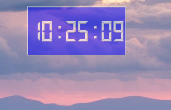

# 📌 桌面悬浮工具实战：无边框可拖拽电子时钟

**拖拽原理的数学公式**：

`鼠标偏移量 = 鼠标全局坐标 - 窗口左上角坐标`；

移动时 `窗口新坐标 = 当前鼠标全局坐标 - 偏移量`。

这个公式适用于所有无边框窗口拖拽的实现。

**闪烁逻辑**：本质上是对字符串指定索引（`text[2]`）进行替换，配合 `bool` 标志位切换。

**📂 项目路径**：`QT/ElectronicClock`

**🎯 项目背景：**
现代桌面软件经常需要制作一些“悬浮小工具”（如桌面时钟、悬浮便签、网速监控悬浮窗）。本项目通过继承 `QLCDNumber`，实现了一个去除系统边框、半透明、可随意拖拽、且带有闪烁冒号的桌面电子时钟。




## 🌍 一、典型使用场景

1. **桌面悬浮钟表/倒计时**：如各类考试专用的桌面倒计时工具。
2. **系统监控悬浮窗**：如 360 加速球、实时网速/CPU温度监控小窗。
3. **无边框播放器**：极简音乐播放器、歌词悬浮窗。

## 🛠️ 二、核心技术栈拆解

### 1. 数字显示控件 (`QLCDNumber`)

- 提供类似电子表的七段数码管显示效果。
- **关键 API**：
  - `setDigitCount(8)`：设置显示的位数（如 `HH:mm:ss` 需要 8 位）。
  - `display(QString)`：要显示的字符串，**仅支持数字、字母及少数符号**（空格可用）。

### 2. 窗口无边框与半透明

- `setWindowFlags(Qt::FramelessWindowHint);`：去掉系统自带的标题栏和边框。
- `setWindowOpacity(0.5);`：设置全局窗口透明度（0.0 全透明，1.0 不透明）。
- **⚠️ 关联坑点**：去掉系统边框后，窗口不仅没法拖拽，还没法关闭，必须依靠代码重写鼠标事件来实现。

### 3. 调色板 (`QPalette`)

- 本项目通过 `palette()` 获取当前控件的调色板，修改了以下角色：
  - `QPalette::Window`：窗口背景色（设为蓝色）。
  - `QPalette::WindowText`：窗口文字颜色（设为白色）。

### 4. 闪烁冒号逻辑

- `text[2] = ':'` 和 `text[2] = ' '` 交替切换。通过一个 `bool showColon` 标志位，在每次定时器触发（每秒）时取反，实现“秒针闪动”的效果。

### 5. 无边框窗口的拖拽原理（核心难点）

- 分为两步：
  1. **`mousePressEvent`**：按下左键时，记录鼠标在屏幕上的**全局坐标**与窗口左上角的**偏移量** `dragPosition`。
  2. **`mouseMoveEvent`**：按住左键移动时，用当前的**全局坐标**减去刚才记录的**偏移量**，得到窗口左上角的新坐标，调用 `move()` 移动窗口。

## ⚠️ 三、工程化实战避坑与进阶指南

### 🚨 坑点 1：`globalPos()` 的废弃警告

- Qt 6 中 `QMouseEvent::globalPos()` 已废弃，会编译警告。
- **✅ 解决方案**：改用 `event->globalPosition().toPoint()`。

### 🚨 坑点 2：`frameGeometry()` 与 `geometry()` 的区别

- 在有系统边框时，`frameGeometry().topLeft()` 是窗口**外边框**的左上角，而 `geometry().topLeft()` 是窗口**内容区**的左上角。
- 本项目取消了边框，两者基本一致，但为了在通用场景下兼容，建议使用 `event->globalPos() - pos()`（`pos()` 返回控件相对父窗口的坐标，顶置时与屏幕坐标一致）。

### 🚨 坑点 3：半透明与背景色的冲突

- 如果设置了 `setWindowOpacity(0.5)`，再给 `QPalette::Window` 设置纯蓝色，文字会显得不够清晰。
- **✅ 优化建议**：实际项目中，建议用 QSS 设置半透明背景色（如 `background-color: rgba(0, 0, 255, 0.5);`），同时将 `WindowOpacity` 保持为 1.0，这样文字就不会跟着变透明，视觉体验更好。

### 🚨 坑点 4：内存泄漏与父对象

- `QTimer *timer = new QTimer(this);` 中的 `this` 保证了定时器会随窗口销毁而自动释放。如果不加 `this`，且未手动 `delete`，会引发内存泄漏。

## 💻 四、核心代码实现

### 1. 头文件 (`digiclock.h`)

```cpp
#ifndef DIGICLOCK_H
#define DIGICLOCK_H

//#include <QDialog>
#include <QLCDNumber>

#include <QTimer>
#include <QTime>
#include <QLCDNumber>
#include <QPalette>
#include <QMouseEvent>

// 通过实现显示于桌面上并可随意拖曳至桌面任意位置的电子时钟综合实例，
// 实践 QPalette 类、 QTime 类和 mousePressEvent/mouseMoveEvent 类的用法

// 继承QLCDNumber类，该类中重定义了鼠标按下事件和鼠标移动事件以使电子时钟可随意拖拽，同时还定义了相关的槽函数和私有变量
class DigiClock : public QLCDNumber
{
    Q_OBJECT

public:
    DigiClock(QWidget *parent = nullptr);
    ~DigiClock();

protected: // 建议设为 protected，因为这是事件处理函数
    void mousePressEvent(QMouseEvent *event) override;
    void mouseMoveEvent(QMouseEvent *event) override;

private slots:
    void showTime();// 显示当前的时间

private:
    QPoint dragPosition;// 保存鼠标点相对电子时钟窗体左上角的偏移值
    bool showColon;// 用于显示时间时是否显示“:”
};
#endif // DIGICLOCK_H

```

### 2. 核心逻辑 (`digiclock.cpp`)

```cpp
#include "digiclock.h"

// 完成外观的设置和定时器的初始化操作

DigiClock::DigiClock(QWidget *parent)
    : QLCDNumber(parent)
{
    // 窗口无边框与半透明设置
    setWindowFlags(Qt::FramelessWindowHint);
    resize(200,100);
    setWindowOpacity(0.5);// 设置窗体的透明度为0.5，即半透明,值越小越透明
    // LCD显示设置
    setDigitCount(8);// 设置电子时钟显示的位数，默认只显示5位

    // 设置时钟背景
    QPalette p = palette();
    // 设置时钟窗体的背景颜色
    p.setColor(QPalette::Window,Qt::blue);
    p.setColor(QPalette::WindowText,Qt::white);
    setPalette(p);

    QTimer *timer = new QTimer(this);// 定时器对象
    connect(timer,&QTimer::timeout,this,&DigiClock::showTime);
    timer->start(1000);// 以1s为周期启动定时器

    showTime();// 初始的时候显示一次时间

    showColon = true;// 默认显示":"
}

DigiClock::~DigiClock()
{
}

/*
mousePressEvent：鼠标按下事件（重写QLCDNumber自带的鼠标事件）
逻辑：
- 如果按下【鼠标左键】：记录鼠标相对于窗口左上角的偏移量 dragPosition
- 如果按下【鼠标右键】：关闭这个时钟窗口
*/
void DigiClock::mousePressEvent(QMouseEvent *event)
{
    if(event->button() == Qt::LeftButton){
        // globalPos()：鼠标在屏幕上的绝对坐标
        // frameGeometry().topLeft()：窗口左上角在屏幕上的坐标
        // 两者相减 = 鼠标点距离窗口左上角的偏移，拖动的时候要用
        dragPosition = event->globalPos() - frameGeometry().topLeft();
        event->accept();// 接收这个事件，不再往下传递
    }
    if(event->button() == Qt::RightButton){
        close();// 右键按下，关闭窗口
    }
}

/*
mouseMoveEvent：鼠标移动事件
event->buttons()：当前按住了哪些鼠标按键（可以同时多个）
判断：是否按住左键
如果按住左键：
    用鼠标当前屏幕坐标 - 刚才记录的偏移量，得到窗口左上角应该放到哪里，调用move移动窗口
*/
void DigiClock::mouseMoveEvent(QMouseEvent *event)
{
    if(event->buttons() & Qt::LeftButton){
        move(event->globalPos() - dragPosition);
        event->accept();
    }
}

void DigiClock::showTime()
{
    // 获取当前系统的时间
    QTime time = QTime::currentTime();
    QString text = time.toString("hh:mm:ss");
    // 这个if...else...主要体现在“:”可以动，更灵活
    if(showColon){
        text[2] = ':';
        showColon = false;
    }else{
        text[2] = ' ';
        showColon = true;
    }
    display(text);// QLCDNumber中显示字符串s 所表示的数字的公共函数display(const QString &s)
}


```

