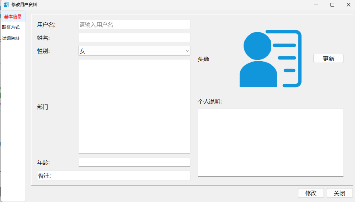

# 📌 终极综合实战：多页面用户资料修改系统 (UserInfoManager)



**📂 项目路径**：`QT/MultiPageUserInfoDialog`

**🎯 项目背景：**
这是一个企业级后台管理系统的经典界面原型。左侧导航切换，右侧多页面表单填写，底部配有操作按钮。本项目一次性融合了 `QSplitter`（分割器）、`QListWidget`（列表）、`QStackedWidget`（堆栈窗体）、`QGridLayout`（网格布局）、`QComboBox`（下拉框）以及自定义信号与 `QSS` 样式表。

## 🌍 一、典型使用场景

1. **企业后台管理系统**：用户管理、权限配置、系统设置。左侧点击“基本信息”、“安全设置”，右侧无缝切换对应的表单。
2. **复杂的数据录入软件**：如医院的患者信息登记、学校的学籍管理系统。大量表单字段需要分类呈现（用 `QStackedWidget` 划分成多个页面）。
3. **偏好设置窗口**（如 VS Code 的 Settings）：左侧列出所有分类，右侧展示对应分类下的输入框。

## 🏗️ 二、核心架构拆解

本项目的 UI 结构分为四大层：

1. **最外层框架 (`QSplitter`)**：作为主窗口，水平分割。左侧占 1 份宽（导航区），右侧占 5 份宽（内容区），用户可以自由拖拽调整。
2. **左侧导航 (`QListWidget`)**：包含“基本信息”、“联系方式”、“详细资料”三项条目。
3. **右侧核心 (`QStackedWidget`)**：包含三个独立的自定义 `QWidget` 页面（`BaseInfo`、`Contact`、`Detail`），同一时间只显示一页，靠左侧列表联动切换。
4. **底部操作栏 (`QHBoxLayout`)**：利用 `addStretch(1)` 添加弹簧，将“修改”和“关闭”按钮优雅地挤到最右侧。

## 🛠️ 三、核心技术亮点拆解

### 1. 信号槽的跨类联动

在 `main.cpp` 中，将左侧列表的索引变化，直接绑定到右侧容器对象的公开槽函数：

```cpp
// 当左侧列表选中行变化时，右侧堆栈窗体自动切换到对应页面
QObject::connect(list, &QListWidget::currentRowChanged, content->stack, &QStackedWidget::setCurrentIndex);

// 当内容页面发出关闭信号时，关闭整个顶层主窗口
QObject::connect(content, &MultiPageUserInfoDialog::sigCloseWindow, mainSplitter, &QSplitter::close);
```

### 2. 下拉框级联联动 (`Detail` 页面)

监听国家下拉框的 `currentTextChanged` 信号，动态清空并加载省份下拉框的数据。

```cpp
connect(countryComboBox, &QComboBox::currentTextChanged, this, &Detail::onCountryChanged);

void Detail::onCountryChanged(const QString &countryName) {
    provenceComboBox->clear(); // 先清空旧的省份列表
    if(countryName == "中国") {
        provenceComboBox->addItems({"安徽省", "江苏省", "江西省"});
    } else if (countryName == "美国") {
        provenceComboBox->addItems({"加利福尼亚州", "德克萨斯州", "纽约州"});
    } // ...
}
```

### 3. 复杂布局嵌套 (`BaseInfo` 页面)

- **左侧表单**：使用 `QGridLayout`。通过 `setColumnStretch(0, 1)` 和 `setColumnStretch(1, 3)` 实现标签与输入框的 1:3 宽度比例。
- **右侧头像区**：将头像、按钮用 `QHBoxLayout` 水平排列。
- **右侧整体**：头像区与个人说明用 `QVBoxLayout` 垂直组合。
- **大框架**：左右两列再次用 `QGridLayout` 组合。

### 4. QSS 样式表动态加载

通过 `QFile` 读取外部的 `.qss` 文件，并应用到整个应用程序：

```cpp
QFile file(":/styles/style.qss");
if(file.open(QIODevice::ReadOnly | QIODevice::Text)) {
    QString styleSheet = QString::fromUtf8(file.readAll());
    qApp->setStyleSheet(styleSheet);
}
```

## ⚠️ 四、实战避坑与经验总结

### 🚨 史诗级大坑：QDialog 无法嵌入 QSplitter

- **现象**：如果在把 `MultiPageUserInfoDialog` 嵌入到 `QSplitter` 时使用 `QDialog` 作为基类，运行时会出现**界面完全空白**。

- **原因**：`QDialog` 自带顶层窗口标记，本质是独立的系统弹窗，不能被 `QSplitter` 当作普通子控件进行布局管理。

- **✅ 解决方案**：必须把该类的基类从 `QDialog` 改为 `QWidget`。

- **经验总结**：

  | 控件基类      | 使用场景                                                     |
  | ------------- | ------------------------------------------------------------ |
  | `QDialog`     | 独立弹窗（如登录框、关于我们）。                             |
  | `QMainWindow` | 主程序外壳（带菜单栏、状态栏）。                             |
  | **`QWidget`** | **凡是需要被塞进布局、Splitter、StackedWidget 里的“页面/面板”，一律使用 `QWidget`。** |

### 🚨 坑点 2：按钮布局不对齐

- **现象**：如果直接把按钮加到布局里，按钮会全部挤在左边。
- **✅ 解决方案**：使用 `btnLayout->addStretch(1);` 插入弹簧，把按钮推到右侧，且窗口拉伸时始终保持对齐。

### 🚨 坑点 3：QSS 文件加载失败

- **现象**：程序编译成功，但界面样式没有生效。
- **✅ 解决方案**：检查 `.qrc` 资源文件是否已生成且已编译（需要执行 `qmake`），检查文件路径是否拼写正确。

## 💻 五、核心代码结构展示

### 1. 主入口 (`main.cpp`)

```cpp
int main(int argc, char *argv[])
{
    QApplication a(argc, argv);
    QFont font("Microsoft YaHei", 12);
    a.setFont(font);

    // 1. 创建主分割器
    QSplitter *mainSplitter = new QSplitter(Qt::Horizontal, 0);
    mainSplitter->setOpaqueResize(true);

    // 2. 左侧导航
    QListWidget *list = new QListWidget(mainSplitter);
    list->addItem("基本信息");
    list->addItem("联系方式");
    list->addItem("详细资料");

    // 3. 右侧内容（多页面容器）
    MultiPageUserInfoDialog *content = new MultiPageUserInfoDialog(mainSplitter);
    mainSplitter->setStretchFactor(0, 1);
    mainSplitter->setStretchFactor(1, 5);

    // 4. 核心联动：选中列表项，切换右侧页面
    QObject::connect(list, &QListWidget::currentRowChanged, content->stack, &QStackedWidget::setCurrentIndex);
    QObject::connect(content, &MultiPageUserInfoDialog::sigCloseWindow, mainSplitter, &QSplitter::close);

    // 5. 设置标题、图标与 QSS
    mainSplitter->setWindowTitle(QObject::tr("修改用户资料"));
    mainSplitter->setWindowIcon(QIcon(":/Icons/usernfo.png"));

    QFile file(":/styles/style.qss");
    if(file.open(QIODevice::ReadOnly | QIODevice::Text)) {
        qApp->setStyleSheet(QString::fromUtf8(file.readAll()));
        file.close();
    }
    mainSplitter->show();
    return a.exec();
}
```

### 2. 多页面容器 (`MultiPageUserInfoDialog`)

```cpp
MultiPageUserInfoDialog::MultiPageUserInfoDialog(QWidget *parent) : QWidget(parent)
{
    stack = new QStackedWidget(this);
    stack->setFrameStyle(QFrame::Panel | QFrame::Raised);

    baseInfo = new BaseInfo();
    contact = new Contact();
    detail = new Detail();
    stack->addWidget(baseInfo);
    stack->addWidget(contact);
    stack->addWidget(detail);

    // 底部按钮区
    modifyButton = new QPushButton("修改");
    closeButton = new QPushButton("关闭");
    QHBoxLayout *btnLayout = new QHBoxLayout;
    btnLayout->addStretch(1);
    btnLayout->addWidget(modifyButton);
    btnLayout->addWidget(closeButton);

    // 右侧整体垂直布局
    rightLayout = new QVBoxLayout(this);
    rightLayout->setMargin(10);
    rightLayout->setSpacing(6);
    rightLayout->addWidget(stack);
    rightLayout->addLayout(btnLayout);

    connect(closeButton, &QPushButton::clicked, this, &MultiPageUserInfoDialog::closeDialog);
}
```

