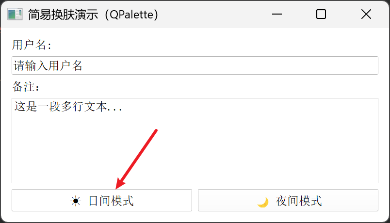
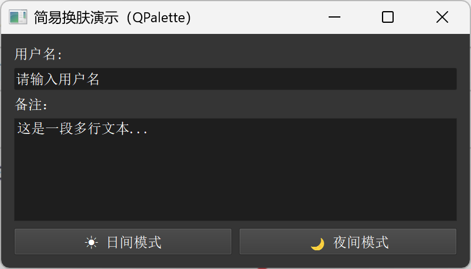

# 📌 全局换肤机制：QPalette 调色板实战





**📂 项目路径**：`QT/Palette`

**🎯 项目背景：**
现代软件几乎都标配了“日间/夜间模式”。本项目通过极简的代码实现了全局一键换肤。核心在于深入理解 Qt 的调色板机制 `QPalette`，以及掌握如何通过 `qApp->setPalette()` 瞬间将配色方案应用到整个应用程序的所有控件上。

## 🌍 一、典型使用场景

1. **日间/夜间模式切换**：如微信、VS Code、各类阅读软件，通过切换 `QPalette` 降低夜间屏幕刺眼度。
2. **品牌色定制**：某些企业级软件交付给不同客户时，仅需修改 `QPalette` 里的主色调，就能瞬间符合客户的品牌 VI。
3. **无障碍模式（高对比度）**：为视力不佳的用户提供黑底黄字的高对比度调色板。

## 🛠️ 二、核心知识点与底层原理拆解

### 1. 什么是 `QPalette`？

`QPalette` 是 Qt 中负责管理控件**颜色角色 (ColorRole)** 的类。它不关心控件具体长什么样，只负责定义“在这个控件上，背景用什么色、文字用什么色、高亮用什么色”。

### 2. 核心的颜色角色 (`QPalette::ColorRole`)

`QPalette` 内部划分为多个“颜色分组”，最常用的有：

| 角色枚举               | 控制范围                                       |
| ---------------------- | ---------------------------------------------- |
| `QPalette::Window`     | 普通窗口的背景色                               |
| `QPalette::WindowText` | 普通窗口上的文字颜色（如 `QLabel`）            |
| `QPalette::Base`       | 输入类控件（`QLineEdit`、`QTextEdit`）的背景色 |
| `QPalette::Text`       | 输入类控件里的文字颜色                         |
| `QPalette::Button`     | 按钮的背景色                                   |
| `QPalette::ButtonText` | 按钮上的文字颜色                               |
| `QPalette::Highlight`  | 选中文字时的背景高亮色                         |

### 3. 全局与局部的区别

- **局部换肤**：`this->setPalette(pal);` （仅对当前窗口及其子控件生效）。
- **全局换肤（本项目所用）**：`qApp->setPalette(pal);` （对当前运行的整个 Qt 应用程序生效，所有打开的窗口都会瞬间变色）。

## ⚠️ 三、实战避坑与进阶指南

### 🚨 坑点 1：QPalette 与 QSS 的优先级冲突

- **现象**：你通过 `QPalette` 设置了全局黑色背景，但发现某个按钮还是白色的。
- **原因**：如果你之前给这个按钮写过 QSS 样式（如 `background-color: white;`），**QSS 的优先级永远高于 QPalette**。
- **✅ 解决方案**：要么彻底不用 QSS 管颜色，要么用 QSS 的全局变量（通过重新加载不同 `.qss` 文件）来实现换肤。两者选其一，不要混用。

### 🚨 坑点 2：默认风格 (Fusion) 的坑

- **现象**：在某些 Windows 系统下，修改 `QPalette::Button` 颜色，按钮看起来毫无变化。

- **原因**：Windows 系统默认的原生样式（`WindowsVista` 风格）会接管按钮的绘制，拒绝接受 `QPalette` 的强行修改。

- **✅ 解决方案**：如果需要通过 `QPalette` 深度修改颜色，建议在 `main.cpp` 中强制将应用程序风格设置为 `Fusion`（Qt 自带的跨平台现代风格）

- ```cpp
  QApplication::setStyle(QStyleFactory::create("Fusion"));
  ```

### 🚨 坑点 3：输入框背景色不生效

- **现象**：修改了 `Window` 的背景色，但 `QLineEdit` 里面还是白色的。
- **原因**：输入框的背景色不是 `Window` 控制的，而是 `Base` 控制的。必须同时设置 `QPalette::Base`。

## 💻 四、核心代码实现

### 1. 头文件 (`themechange.h`)

```cpp
#ifndef THEMECHANGE_H
#define THEMECHANGE_H

#include <QWidget>
#include <QVBoxLayout>
#include <QHBoxLayout>
#include <QLabel>
#include <QLineEdit>
#include <QTextEdit>
#include <QPushButton>
#include <QPalette>

class ThemeChange : public QWidget
{
    Q_OBJECT

public:
    ThemeChange(QWidget *parent = nullptr);
    ~ThemeChange();

private:
    // 核心封装：提取通用的换肤函数
    void applyTheme(const QColor &bgColor, const QColor &textColor, const QColor &baseColor);

private slots:
    void applyLightTheme();
    void applyDarkTheme();
};
#endif // THEMECHANGE_H
```

### 2. 核心逻辑 (`themechange.cpp`)

```cpp
#include "themechange.h"
#include <QApplication>

ThemeChange::ThemeChange(QWidget *parent) : QWidget(parent)
{
    setWindowTitle("简易换肤演示（QPalette）");
    resize(800, 400);

    QVBoxLayout *layout = new QVBoxLayout(this);
    layout->addWidget(new QLabel("用户名:"));
    layout->addWidget(new QLineEdit("请输入用户名"));
    layout->addWidget(new QLabel("备注："));
    layout->addWidget(new QTextEdit("这是一段多行文本..."));

    QHBoxLayout *btnLayout = new QHBoxLayout();
    QPushButton *btnLight = new QPushButton("☀️ 日间模式");
    QPushButton *btnDark = new QPushButton("🌙 夜间模式");
    btnLayout->addWidget(btnLight);
    btnLayout->addWidget(btnDark);
    layout->addLayout(btnLayout);

    connect(btnLight, &QPushButton::clicked, this, &ThemeChange::applyLightTheme);
    connect(btnDark, &QPushButton::clicked, this, &ThemeChange::applyDarkTheme);
}

// 核心封装：只要传三个基础颜色，就能调配出完整的主题
void ThemeChange::applyTheme(const QColor &bgColor, const QColor &textColor, const QColor &baseColor)
{
    QPalette appPal = qApp->palette(); // 获取当前全局调色板

    // 1. 设置窗口背景与文字
    appPal.setColor(QPalette::Window, bgColor);
    appPal.setColor(QPalette::WindowText, textColor);

    // 2. 设置输入框（QLineEdit / QTextEdit）背景与文字
    appPal.setColor(QPalette::Base, baseColor);
    appPal.setColor(QPalette::Text, textColor);

    // 3. 设置按钮背景与文字
    appPal.setColor(QPalette::Button, bgColor);
    appPal.setColor(QPalette::ButtonText, textColor);

    // 应用到全局
    qApp->setPalette(appPal);
}

void ThemeChange::applyLightTheme()
{
    // 日间模式：白底黑字
    applyTheme(Qt::white, Qt::black, Qt::white);
}

void ThemeChange::applyDarkTheme()
{
    // 夜间模式：深灰底，白字，深色输入框
    applyTheme(QColor(53, 53, 53), Qt::white, QColor(30, 30, 30));
}
```

