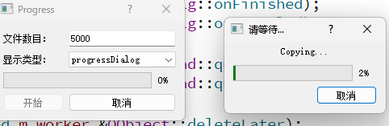

# 📌 综合实战：Qt 多线程进度模拟演示程序



📂 项目路径：QT/Progress

🎯 项目背景： 这是一个 Qt `moveToThread` 多线程经典学习 Demo，模拟文件拷贝耗时任务。支持两种进度展示方式切换：内嵌在窗口内的 `QProgressBar`、弹出式 `QProgressDialog`。 项目融合：`QThread` + `QObject::moveToThread`、自定义信号槽、`QAtomicInt` 原子标记、`QProgressBar`、`QProgressDialog`、`QComboBox`、布局管理。

## 🌍 一、典型使用场景

- 后台耗时任务模拟：文件拷贝、文件解压、数据导出、批量处理
- 需要实时进度刷新、支持中途取消的程序
- 学习 Qt 标准多线程写法（Worker 模式，面试高频）
- 对比两种进度组件差异：嵌入式进度条 vs 弹窗进度框

## 🏗️ 二、核心架构拆解 程序分为两大模块：

1. Worker 任务模块（CopyWorker）：纯业务任务类，继承 QObject，运行在子线程，不碰任何 UI 控件
   - 接收开始指令，循环模拟耗时操作
   - 定时发送进度信号、完成信号、取消信号
   - 使用 `QAtomicInt` 原子变量做取消标记，无锁线程安全
2. UI 界面模块（ProgressDlg）：主线程界面，只负责展示、接收用户操作、信号转发
   - 输入框：设置模拟任务步数
   - 下拉框：切换进度展示模式（内嵌 QProgressBar / QProgressDialog 弹窗）
   - 开始按钮：启动任务，运行时禁用防止重复点击
   - 取消按钮：设置原子标记，通知子线程退出
   - 信号接收槽函数：接收子线程进度，更新对应进度控件

## 🛠️ 三、核心技术亮点拆解

### 1. Qt 标准 Worker 多线程（moveToThread）信号链路

```cpp
// 线程启动后自动执行任务函数 doWork
connect(m_thread, &QThread::started, m_worker, &CopyWorker::doWork);
// 子线程推送进度信号到UI
connect(m_worker, &CopyWorker::progressChanged, this, &ProgressDlg::onProgress);
// 任务正常完成、被取消，都通知线程退出
connect(m_worker, &CopyWorker::finished, m_thread, &QThread::quit);
connect(m_worker, &CopyWorker::canceled, m_thread, &QThread::quit);
// 线程退出后自动释放worker对象，防止内存泄漏
connect(m_thread, &QThread::finished, m_worker, &QObject::deleteLater);
```

> 核心原则：**子线程里面不能操作任何 UI 控件，UI 更新全部靠信号投递到主线程槽函数**

### 2. QAtomicInt 原子取消标记（线程安全）

```cpp
// 标记：0=正常运行，1=请求取消
QAtomicInt m_cancel{0};

// UI调用cancel，赋值为1
void CopyWorker::cancel()
{
    m_cancel.fetchAndStoreOrdered(1);
}

// 子线程循环内判断
if(m_cancel.load())
{
    emit canceled();
    return;
}
```

> 优势：不需要 QMutex 互斥锁，轻量，专门用于多线程标记位。

### 3. 两种进度控件独立配置（高频踩坑点）

- `QProgressBar`：内嵌控件，不会自动弹出、自动关闭；范围独立设置
- `QProgressDialog`：弹窗控件，**拥有独立的 setRange**，默认范围 0~100；自带 `setMinimumDuration` 预估弹出机制

```cpp
// QProgressDialog必须单独设置范围，否则数值超过100就判定完成
m_progressDlg->setRange(0, num);
// 设置为0：关闭耗时预估，只要收到进度就一定会弹出弹窗
m_progressDlg->setMinimumDuration(0);
```

弹窗自带取消按钮，点击后同样触发取消逻辑，一套取消逻辑复用。

### 4. 状态保护，防止重复启动

```cpp
if(m_thread)
{
    return;
}
startBtn->setEnabled(false); // 运行时禁用开始按钮
```

任务结束 / 取消后，指针置空，恢复按钮状态，避免野指针、重复创建线程。

## ⚠️ 四、实战避坑与经验总结

| 坑                                           | 现象                         | 原因                                                         | 解决方案                                                     |
| -------------------------------------------- | ---------------------------- | ------------------------------------------------------------ | ------------------------------------------------------------ |
| QProgressDialog 提前消失，控制台还在打印进度 | 弹窗早就没了，子线程还在跑   | ① 没有给 QProgressDialog setRange；<br />② setMinimumDuration 阈值过高，Qt 预估任务很快跑完，直接不弹窗 | 补充 `setRange(0,num)`，测试时设置 `setMinimumDuration(0)`   |
| 进度条肉眼不动                               | 数字很大的时候进度几乎不移动 | 每步 sleep (50ms)，总步数太大；进度条像素跨度极大，需要涨很多数值才移动一格 | 测试输入 50~200；进阶可以隔 N 步才发一次进度信号             |
| 布局异常                                     | 控件看不见、位置错乱         | QGridLayout addWidget 列跨度参数填 0                         | 跨度写大于 0 的值，例：`addWidget(proBar,2,0,1,2)`           |
| 重复点击开始，多线程错乱                     | 多次启动任务，信号混乱       | 没有判断线程指针、没有禁用按钮                               | 启动前判断 `if(m_thread)` return，运行时禁用开始按钮         |
| 线程结束内存泄漏                             | worker 对象没有释放          | 没有绑定 finished + deleteLater                              | 固定绑定 `connect(m_thread, &QThread::finished, m_worker, &QObject::deleteLater);` |

## 💻 五、核心代码结构展示

#### CopyWorker.h

```cpp
#ifndef COPYWORKER_H
#define COPYWORKER_H
#include <QObject>
#include <QAtomicInt>

class CopyWorker : public QObject
{
    Q_OBJECT
public:
    explicit CopyWorker(int totalSteps, QObject *parent = nullptr);
    // 设置取消标记
    void cancel();

signals:
    void progressChanged(int value);
    void finished();
    void canceled();

public slots:
    void doWork();

private:
    int m_totalSteps;
    // 取消标记：0正常，1取消
    QAtomicInt m_cancel{0};
};

#endif // COPYWORKER_H
```

#### CopyWorker.cpp

```cpp
#include "CopyWorker.h"
#include <QThread>

CopyWorker::CopyWorker(int totalSteps, QObject *parent)
    : QObject(parent), m_totalSteps(totalSteps)
{

}

void CopyWorker::cancel()
{
    m_cancel.fetchAndStoreOrdered(1);
}

void CopyWorker::doWork()
{
    // 任务启动，重置取消标记
    m_cancel.fetchAndStoreOrdered(0);
    for(int i = 0; i <= m_totalSteps; ++i)
    {
        if(m_cancel.load())
        {
            emit canceled();
            return;
        }
        QThread::msleep(50);
        emit progressChanged(i);
    }
    emit finished();
}
```

#### ProgressDlg.h

```cpp
#ifndef PROGRESSDLG_H
#define PROGRESSDLG_H
#include <QDialog>
#include <QLabel>
#include <QLineEdit>
#include <QComboBox>
#include <QPushButton>
#include <QProgressBar>
#include <QProgressDialog>
#include <QThread>
#include "CopyWorker.h"

class ProgressDlg : public QDialog
{
    Q_OBJECT
public:
    ProgressDlg(QWidget *parent = nullptr);
    ~ProgressDlg();

private slots:
    void startWork();
    void onProgress(int value);
    void onFinished();
    void onCanceled();

private:
    QLabel *tipLabel;
    QLineEdit *numEdit;
    QComboBox *modeCombo;
    QPushButton *startBtn;
    QPushButton *cancelBtn;
    QProgressBar *proBar;

    QThread *m_thread = nullptr;
    CopyWorker *m_worker = nullptr;
    QProgressDialog *m_progressDlg = nullptr;
};

#endif // PROGRESSDLG_H
```

#### ProgressDlg.cpp

```cpp
#include "ProgressDlg.h"
#include <QHBoxLayout>
#include <QVBoxLayout>
#include <QGridLayout>
#include <qdebug.h>

ProgressDlg::ProgressDlg(QWidget *parent)
    : QDialog(parent)
{
    this->setWindowTitle("多线程进度模拟");
    tipLabel = new QLabel("输入步数：");
    numEdit = new QLineEdit("50");
    modeCombo = new QComboBox;
    modeCombo->addItem("内嵌QProgressBar");
    modeCombo->addItem("弹窗QProgressDialog");

    startBtn = new QPushButton("开始");
    cancelBtn = new QPushButton("取消");
    proBar = new QProgressBar;

    QGridLayout *gridLayout = new QGridLayout;
    gridLayout->addWidget(tipLabel,0,0);
    gridLayout->addWidget(numEdit,0,1);
    gridLayout->addWidget(modeCombo,0,2);

    QHBoxLayout *btnLayout = new QHBoxLayout;
    btnLayout->addStretch(1);
    btnLayout->addWidget(startBtn);
    btnLayout->addWidget(cancelBtn);

    QVBoxLayout *mainLayout = new QVBoxLayout(this);
    mainLayout->addLayout(gridLayout);
    mainLayout->addWidget(proBar);
    mainLayout->addLayout(btnLayout);

    connect(startBtn, &QPushButton::clicked, this, &ProgressDlg::startWork);
    connect(cancelBtn, &QPushButton::clicked, this, [this](){
        if(m_worker)
        {
            m_worker->cancel();
        }
    });
}

ProgressDlg::~ProgressDlg()
{
    if(m_thread)
    {
        m_thread->quit();
        m_thread->wait();
    }
}

void ProgressDlg::startWork()
{
    if(m_thread)
    {
        return;
    }
    bool ok;
    int num = numEdit->text().toInt(&ok);
    if(!ok || num <= 0)
    {
        return;
    }
    proBar->setRange(0, num);
    proBar->setValue(0);

    m_thread = new QThread(this);
    m_worker = new CopyWorker(num);
    m_worker->moveToThread(m_thread);

    connect(m_thread, &QThread::started, m_worker, &CopyWorker::doWork);
    connect(m_worker, &CopyWorker::progressChanged, this, &ProgressDlg::onProgress);
    connect(m_worker, &CopyWorker::finished, m_thread, &QThread::quit);
    connect(m_worker, &CopyWorker::canceled, m_thread, &QThread::quit);
    connect(m_thread, &QThread::finished, m_worker, &QObject::deleteLater);

    // 弹窗模式：创建QProgressDialog并绑定取消信号
    if(modeCombo->currentIndex() == 1)
    {
        m_progressDlg = new QProgressDialog(this);
        m_progressDlg->setRange(0, num);
        m_progressDlg->setWindowModality(Qt::WindowModal);
        m_progressDlg->setMinimumDuration(0);
        m_progressDlg->setWindowTitle("请等待...");
        m_progressDlg->setLabelText("正在模拟拷贝...");
        m_progressDlg->setCancelButtonText("取消");
        connect(m_progressDlg, &QProgressDialog::canceled, this, [this](){
            if(m_worker)
            {
                m_worker->cancel();
            }
        });
    }
    startBtn->setEnabled(false);
    m_thread->start();
}

void ProgressDlg::onProgress(int value)
{
    qDebug() << "当前进度：" << value;
    if(modeCombo->currentIndex() == 0)
    {
        proBar->setValue(value);
    }
    else
    {
        if(m_progressDlg)
        {
            m_progressDlg->setValue(value);
        }
    }
}

void ProgressDlg::onFinished()
{
    startBtn->setEnabled(true);
    if(m_progressDlg)
    {
        m_progressDlg->close();
        m_progressDlg->deleteLater();
        m_progressDlg = nullptr;
    }
    m_thread->deleteLater();
    m_thread = nullptr;
    m_worker = nullptr;
}

void ProgressDlg::onCanceled()
{
    startBtn->setEnabled(true);
    proBar->setValue(0);
    if(m_progressDlg)
    {
        m_progressDlg->close();
        m_progressDlg->deleteLater();
        m_progressDlg = nullptr;
    }
    m_thread->deleteLater();
    m_thread = nullptr;
    m_worker = nullptr;
}
```

#### main.cpp

```cpp
#include <QApplication>
#include "ProgressDlg.h"

int main(int argc, char *argv[])
{
    QApplication a(argc, argv);
    ProgressDlg w;
    w.show();
    return a.exec();
}
```

------

✅ 一句话流程串讲 填写步数、选择进度展示模式 → 点击开始，校验输入，创建线程 + worker，moveToThread → 线程启动触发 doWork 循环，不断发送进度信号 → onProgress 根据模式更新进度控件；随时可以点击取消，原子标记让子线程安全退出；任务完成 / 取消后，释放资源，恢复界面状态。