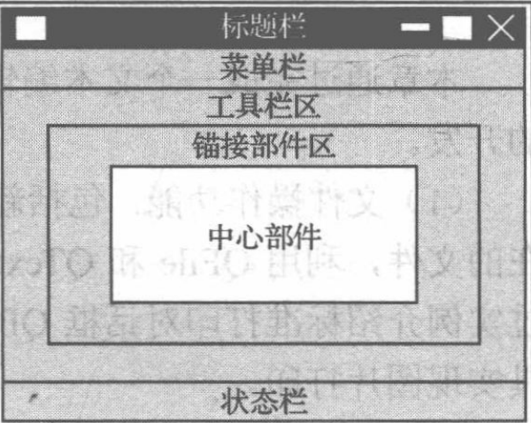
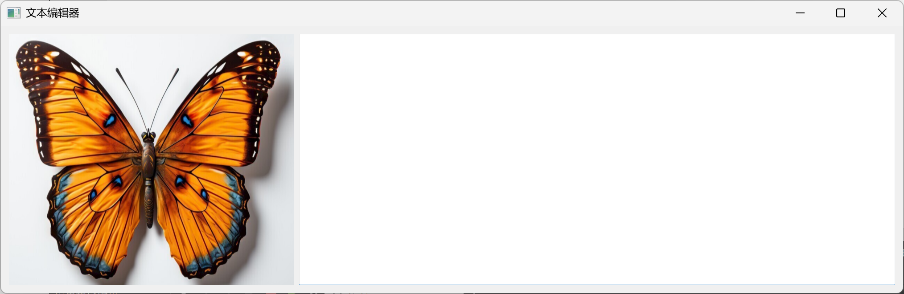

# 📌 桌面应用骨架：QMainWindow 主窗口与文本编辑器实战

**📂 项目路径**：`QT/TextEditor`

**🎯 项目背景：**
`QMainWindow` 是 Qt 中用于构建复杂桌面应用的顶级窗口类。本项目通过开发一个简易文本编辑器（类似 Windows 记事本），系统梳理了主窗口的五大核心布局，并实战了文件读写、文本格式化、排版、图片处理等高频功能。

## 🌍 一、典型使用场景

1. **文本/代码编辑器**：如 Windows 记事本、Notepad++、VS Code。
2. **图像处理软件**：如 Photoshop、画图工具（中心区域放置画布）。
3. **各类 IDE 和办公软件**：如 Word、Excel（中心区域放文档，四周放属性面板）。

## 🏗️ 二、QMainWindow 五大核心构成



`QMainWindow` 继承自 `QWidget`，但额外提供了极其丰富的布局区域：

| 区域                           | 位置         | 功能                                                   |
| ------------------------------ | ------------ | ------------------------------------------------------ |
| **标题栏**                     | 窗口最顶部   | 显示应用名称/文档名，包含最小化、最大化、关闭按钮。    |
| **菜单栏 (`QMenuBar`)**        | 标题栏下方   | 分类放置所有命令（文件、编辑、帮助等）。               |
| **工具栏 (`QToolBar`)**        | 菜单栏下方   | 常用命令的快捷按钮（保存、复制、加粗等），可拖拽停靠。 |
| **锚接部件区 (`QDockWidget`)** | 中心部件外围 | 放置属性面板、图层管理器等辅助面板，支持拖动、浮动。   |
| **中心部件 (`CentralWidget`)** | 窗口正中央   | 应用的核心工作区（如文本编辑区 `QTextEdit`、画布）。   |
| **状态栏 (`QStatusBar`)**      | 窗口最底部   | 显示光标位置、系统时间、连接状态等辅助信息。           |

## 🛠️ 三、综合案例核心功能拆解

### 1. 文件操作功能

- **新建 / 打开**：使用 `QFileDialog::getOpenFileName` 获取路径，用 `QFile` 和`QTextStream`读取文件内容，并显示到 `QTextEdit` 中。
- **保存**：使用 `QFile::write()` 将 `QTextEdit` 的纯文本（`toPlainText()`）写入文件。
- **打印**：借助 `QPrintDialog` 和 `QPrinter` 类，实现纯文本及图片的打印。

### 2. 文本编辑与格式化

- **字体与字号**：调用 `QTextEdit::setFontFamily` 和 `setFontPointSize`。
- **加粗 / 斜体 / 下划线**：通过 `QTextEdit::setFontWeight(QFont::Bold)`、`setFontItalic(true)`、`setFontUnderline(true)` 实现。
- **字体颜色**：使用 `QColorDialog::getColor` 获取颜色后，通过 `setTextColor()` 应用。

### 3. 排版功能

- **撤销 / 重做**：直接调用 `QTextEdit` 自带的槽函数 `undo()` 和 `redo()`。
- **对齐方式**：调用 `setAlignment(Qt::AlignLeft)`、`AlignRight`、`AlignCenter`、`AlignJustify` 等。

### 4. 图片处理功能

- **插入图片**：`QTextEdit::insertHtml("")` 或使用 `QTextCursor` 插入图片资源。
- **图片变换**：用 `QPixmap::transformed(QTransform().rotate(90))` 实现旋转，通过 `scaled()` 实现缩放。

## ⚠️ 四、工程实战避坑与进阶指南

### 🚨 坑点 1：中心部件未设置

- **现象**：界面一片空白，或者放上去的控件无法正常工作。
- **原因**：`QMainWindow` 本身是特殊框架窗口，**它内部已经有一套专属布局用来承载菜单栏、工具栏、dock、状态栏**，它不是一个普通可以直接放 `QVBoxLayout` 的容器控件，没有办法直接给它 `setLayout`。
- **✅ 解决方案**：`QMainWindow` 必须有且仅有一个 `setCentralWidget(QWidget *widget)`，这是所有核心内容的载体。

### 🚨 坑点 2：文件读写未判空

- **现象**：用户点“取消”后程序崩溃。
- **✅ 解决方案**：`QFile::open()` 失败时必须用 `if (!file.open(...)) return;` 或弹窗提示，不要强行读写。

### 🚨 坑点 3：工具栏和菜单栏的图标丢失

- **现象**：按钮显示为文字，没有图标。
- **✅ 解决方案**：使用 `.qrc` 资源文件统一管理图标，并确保路径使用 `:/` 前缀（如 `:/icons/save.png`）。

### 🚨 坑点 4：打开大文件时卡顿

- **现象**：读取几十MB的文件时界面卡死。
- **✅ 解决方案**：把文件读取逻辑放在子线程（`QThread`）中，完成后用信号通知主线程更新 UI。

## 💻 五、核心代码实现

### 1.主框架搭建

```c++
#ifndef SHOWWIDGET_H
#define SHOWWIDGET_H

#include <QWidget>
#include <QLabel>
#include <QImage>
#include <QTextEdit>

// 该工程提供主要显示文本编辑函数所在的文件

class ShowWidget : public QWidget
{
    Q_OBJECT
public:
    explicit ShowWidget(QWidget *parent = nullptr);

    QImage img;
    QLabel *imageLabel;// 显示图像
    QTextEdit *text;// 显示文件内容

signals:

};

#endif // SHOWWIDGET_H

#include "showwidget.h"

#include <QHBoxLayout>

ShowWidget::ShowWidget(QWidget *parent) : QWidget(parent)
{
    imageLabel = new QLabel();
//    imageLabel->setGeometry(0,0,1302,886);
    imageLabel->setScaledContents(true);// 设置标签是否将内容缩放以填满所有可用空间，默认false不填充
    text = new QTextEdit();
    QHBoxLayout *mainLayout = new QHBoxLayout(this);
    mainLayout->addWidget(imageLabel);
    mainLayout->addWidget(text);
}

#include "texteditor.h"

TextEditor::TextEditor(QWidget *parent)
    : QMainWindow(parent)
{
    setWindowTitle("文本编辑器");
    resize(2024,600);
    showWidget = new ShowWidget(this);
    setCentralWidget(showWidget);// 创建设置QLabel和文本编辑框的QWidget对象showWidget，并将该QWidget对象设置为中心部件
//    createActions();
//    createMenus();
//    createToolBars();
    if(img.load(":/images/butterfly.png")){
        // 在imageLabel对象中设置图片
        showWidget->imageLabel->setPixmap(QPixmap::fromImage(img).scaled(showWidget->imageLabel->size(),Qt::IgnoreAspectRatio,Qt::SmoothTransformation));
    }

    fileMenu = new QMenu(this);
}

TextEditor::~TextEditor()
{
}


```



### 2.菜单与工具栏的实现

菜单与工具栏都与QAction类密切相关，工具栏上的工具按钮与菜单中的选项条目相对应，完成相同的功能，使用相同的快捷键与图标，QAction类为用户提供一个统一的命令接口，无论是从菜单触发还是从工具栏触发，或通过快捷键触发都调用同样的操作接口，以达到同样的目的。

**1.动作（Action）的实现**

以下是实现基本文件操作的动作（Action）的代码

