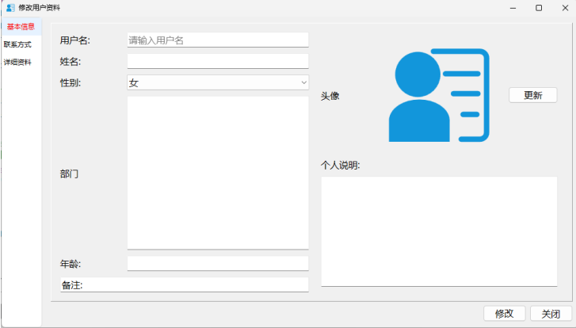

# 🚀 我的编程学习之路   

欢迎来到我的代码仓库！这里记录了我从零开始学习编程的点点滴滴，主要包含 Qt (C++) 基础、算法练习以及日常代码积累。

## 📁 仓库目录

- **`QT/CalculateArea`**：使用 Qt Designer (UI 拖拽) 实现圆面积计算
- **`QT/CalculateArea2`**：纯代码手写实现圆面积计算，加深对控件和布局的理解
- **`QT/QStringPracticeQString`**： QString类常用 API 实操
- **`QT/ContainerPractice`** ：实操了容器类的核心知识点
- **`QT/TimeClock`**：利用纯代码布局（无 `.ui` 文件）实现一个数字时钟，能够实时显示当前的日期（年月日）和时间（时分秒），并带有“开始/暂停”计时功能
- **`QT/CheckableTreeWidget`**：实现带复选框的树形控件
- **`QT/BuddyAssignment`**：实现使用快捷键的方式而不是使用点击按钮来计时
- **`QT/SplitterDemo`**:QSplitter 分割窗口与状态持久化
- **`QT/DockWindows`**：QDockWidget停靠窗口的使用
- **`QT/StackedWidget`**：界面导航神器
- **`QT/UserInfoManager`**：多页面用户资料修改系统

---

## 📝 学习笔记与知识点总结

### 📌 Qt 基础学习
1. **字符串与数字的转换**：
   - 使用 `ui->lineEdit->text().toDouble()` 可以将文本转为浮点数。
   - **进阶用法**：`toDouble(&ok)`。传入一个 `bool` 变量的地址，函数内部不仅返回转换后的数字，还会把是否成功的结果偷偷写进 `ok` 所在的内存地址，完美避免非法输入导致程序崩溃。
2. **UI 显示控制**：
   - 使用 `QString::number(变量, 'f', 2)` 可以强制保留计算结果两位小数。
   - 使用 `label->setAlignment(Qt::AlignLeft | Qt::AlignVCenter);` 可以让多行文本靠左并在垂直方向居中。
3. **内存泄漏防范**：在 Qt 中创建组件（如 `new QLabel`）时，只要有传入 `this` 作为父对象，或者加入了布局（`QGridLayout`），控件就会自动加入到 Qt 的对象树中，在窗口关闭时自动释放，不需要手动 `delete`。

#### 🛡️ 代码严谨性：异常输入拦截（极其重要）
无论是 UI 版本还是纯代码版本，我都加入了完善的“防御性编程”逻辑：
- **空输入拦截**：`if (inputText.isEmpty())`
- **非数字拦截**：利用 `bool ok` 和 `if (!ok)`
- **业务逻辑拦截**：`if (radius < 0)` 拦截不合法的负数半径。

---

#### 💻 核心代码展示 (纯代码布局版)

相比 UI 拖拽，纯代码手写界面让我彻底搞懂了控件的层级和布局（QGridLayout）的使用。以下是 `QT/CalculateArea2` 的核心逻辑：

```cpp
#include <QGridLayout>

// 1. 界面初始化（纯代码布局）
Dialog::Dialog(QWidget *parent) : QDialog(parent)
{
    this->setFixedSize(600, 300);
    radiusLabel = new QLabel("半径", this);
    radiusLineEdit = new QLineEdit(this);
    areaLabel = new QLabel("面积", this);
    areaResultLabel = new QLabel(this);
    areaResultLabel->setAlignment(Qt::AlignLeft | Qt::AlignVCenter);
    countButton = new QPushButton("计算面积", this);
    countButton->setFixedSize(100, 40);

    // 使用表格布局 (行, 列, 跨行, 跨列, 对齐方式)
    QGridLayout *gLayout = new QGridLayout(this);
    gLayout->addWidget(radiusLabel, 0, 0);
    gLayout->addWidget(radiusLineEdit, 0, 1);
    gLayout->addWidget(areaLabel, 1, 0);
    gLayout->addWidget(areaResultLabel, 1, 1);
    gLayout->addWidget(countButton, 2, 0, 1, 2, Qt::AlignCenter); // 按钮跨两列居中

    // 2. 信号与槽连接
    connect(countButton, &QPushButton::clicked, this, &Dialog::showArea);
}

// 3. 核心业务逻辑
void Dialog::showArea()
{
    bool ok;
    QString inputText = radiusLineEdit->text();
    
    if(inputText.isEmpty()){
        areaResultLabel->setText("请输入半径！");
        return;
    }
    
    double result = inputText.toDouble(&ok);
    if(!ok){
        areaResultLabel->setText("请输入有效数字！");
        return;
    }
    
    if(result < 0){
        areaResultLabel->setText("半径不能为负数！");
        return;
    }
    
    const double PI = 3.14;
    double area = result * result * PI;
    areaResultLabel->setText(QString::number(area, 'f', 2));
}

```

### 📌 Qt 进阶核心：信号与槽 (Signals & Slots)

信号与槽是 Qt 实现对象间通信的绝对核心机制。

- **信号 (Signal)**：某个特定情况或动作发生时被触发（比如按钮被点击 `clicked()`）。
- **槽 (Slot)**：等同于接收并处理信号的函数（比如计算面积 `showArea()`）。

#### 1. 连接方式
- **一对一**：`connect(发送者, SIGNAL(信号), 接收者, SLOT(槽))`
- **一对多**：一个信号可以连接多个槽，触发时依次执行。
- **多对一**：多个不同的信号可以连接同一个槽。
- **信号连信号**：一个信号触发另一个信号的发送。

#### 2. 新旧语法的区别（重点！）
- **旧写法（C语言风格字符串）**：`connect(button, SIGNAL(clicked()), this, SLOT(showArea()));` 这种写法编译时查不出错，运行时才会报错。
- **新写法（C++11 函数指针）**：`connect(button, &QPushButton::clicked, this, &Dialog::showArea);` 这种写法编译期就能检查类型，推荐使用。
- *(补充：旧写法底层是用宏把函数名转成了字符串，所以没有类型安全检查。)*

#### 3. 信号与槽的优缺点
- **优点**：
  - **类型安全**：参数类型和个数必须匹配（槽的参数可以比信号少，但必须忽略最后几个参数）。
  - **松散耦合**：发送者不知道接收者是谁，即使接收者在运行时被 `delete` 了，程序也不会崩溃。
- **缺点**：
  - **性能损耗**：比直接调用函数慢约 10 倍。因为需要定位对象、遍历关联、编组参数等。但对于现代 GUI 程序，这点损耗完全可以忽略。
  - 必须继承自 `QObject` 类，且**不支持模板**。

---

### 📌 Qt 元对象系统 (Meta-Object System)

Qt 能在 C++ 基础上实现信号与槽，全靠它独有的“元对象系统”（这是对标准 C++ 的扩展）。它基于三个事实：

1.  **基类 `QObject`**：任何想使用信号槽的类，必须直接或间接继承自 `QObject`。
2.  **`Q_OBJECT` 宏**：必须写在类的 `private` 声明区。它就像个开关，启动了元对象特性。
3.  **`moc` 编译器**：Qt 独有的元对象编译器（Meta-Object Compiler），它会预处理带有 `Q_OBJECT` 的头文件，生成底层的 C++ 代码。

---

### 📌 界面布局管理：QGridLayout

比起手动设定控件的绝对坐标（x, y），使用布局管理器能让界面自适应缩放。今天重点练习了网格布局（`QGridLayout`）：

```cpp
// 创建网格布局对象，并指定父窗口 this
QGridLayout *mainLayout = new QGridLayout(this);

// 添加控件：控件指针, 行号, 列号, 跨行数, 跨列数
mainLayout->addWidget(label1, 0, 0); 
mainLayout->addWidget(lineEdit, 0, 1);
mainLayout->addWidget(label2, 1, 0);
mainLayout->addWidget(button, 1, 1);

// 如果不指定父窗口，最后需要把布局设置给窗口
// setLayout(mainLayout);
```

### 📌 QString 常用 API 实操总结

今天我通过一个完整的 `QString` 测试 Demo，系统验证了其强大的字符串处理能力。重点掌握了以下高频操作：

1. **拼接与格式化**：
   - 强烈推荐 `QString("%1,%2").arg(a).arg(b)`。它比 `+` 号拼接性能更好，且支持强大的占位符替换。
   - `arg(123, 5, 10, QChar('0'))` 这种高级用法可以轻松实现数字补零（输出 `00123`）。
2. **查找与截取**：`indexOf()` 找位置，`left()`、`right()`、`mid()` 随心切分，`section()` 按规则分段。
3. **切割与合并**：`split()` 配合 `QStringList` 可以把逗号分隔的数据拆开，再用 `join()` 拼回来。
4. **空白处理**：`trimmed()` 去除首尾空格，`simplified()` 去除首尾并将中间连续空格压缩为单个，绝对是处理用户表单输入的神器。
5. **数字互转**：`QString::number()` 与 `toInt(&ok)` 结合，通过 `bool` 变量精准拦截非法转换。

### 📌 Qt 容器类与迭代器核心总结

今天通过 `QT/ContainerPractice` 实操了容器类的核心知识点：

1. **QList 基础**：最常用的列表，支持 `<<` 插入、`at()` 安全访问、`indexOf()` 查找。
2. **迭代器三剑客（重点）**：
   - `QListIterator`：Java 风格只读迭代器，用 `hasNext()` 和 `next()`。
   - `QMutableListIterator`：Java 风格读写迭代器，可以在遍历时用 `remove()` 删除或用 `setValue()` 修改元素。
   - `QList<int>::const_iterator`：STL 风格迭代器，像指针一样用 `++` 和 `*`，效率最高，最贴近原生 C++。
3. **QMap vs QHash**：
   - `QMap` 底层是红黑树，自动按 Key 升序排序。
   - `QHash` 底层是哈希表，完全无序，但查找速度极快。
   - *实操发现*：打印 QMap 时是有序的，而打印 QHash 时顺序是随机的。

### 📌 Qt 进阶：QVariant 与 GUI 模块引入

今天测试了 Qt 中极其强大的 `QVariant`（万能类型）类。

1. **什么是 QVariant？**
   它类似于 C++ 的 `union`，但更强大。它可以存 `int`、`double`、`QString`，也能存 `QColor` 甚至容器。利用 `QMap<QString, QVariant>` 可以轻松实现配置文件（混合类型的键值对）。
2. **控制台项目引入 GUI 类的坑**：
   在纯控制台项目（`QCoreApplication`）中使用 `QColor` 会报错。必须在 `.pro` 文件中添加 `QT += gui`，并 `#include <QColor>` 才能正常使用。
3. **取值的两种方式**：
   - 对于 Qt 内置基础类型，直接用 `.toInt()`、`.toString()` 即可。
   - 对于复杂类型（如 `QColor`），必须用模板方式 `.value<QColor>()`，也就是“明确告诉程序从盲盒里掏出什么”。
4. **安全提取**：
   使用 `.canConvert<QColor>()` 先判断类型是否正确，避免强制提取导致乱码或崩溃。

### 📌 Qt 小项目实战：数字时钟与日历

#### 🛠️ 核心技术栈拆解

1. **获取与格式化时间 (`QDateTime`)**
   - 在 Qt 中，`QDateTime::currentDateTime()` 可以获取系统当前的绝对时间和日期。
   - 使用 `.toString()` 函数进行格式化转换：
     - 日期格式：`toString("yyyy-MM-dd")` （`yyyy` 代表四位年份，`MM` 代表月份，`dd` 代表日期）。
     - 时间格式：`toString("HH:mm:ss")` （`HH` 代表 24 小时制，如果是 `hh` 则是 12 小时制；`mm` 是分钟，`ss` 是秒）。
   - **注意**：格式化后的结果依然是 `QString`，可以直接用 `setText()` 赋值给 `QLabel` 显示。
2. **定时器机制 (`QTimer`)**
   - `QTimer` 是 Qt 中实现周期性任务的神器。它就像是一个闹钟，每隔一段时间就会“响”一次。
   - **设置周期**：`timer->setInterval(1000);` 表示周期为 1000 毫秒（即 1 秒）。
   - **启动与停止**：使用 `timer->start()` 启动，`timer->stop()` 停止。
   - **状态判断**：使用 `timer->isActive()` 判断当前定时器是否正在运行，返回 `bool` 值。
3. **信号与槽的动态交互**
   - 核心逻辑：将 `QTimer` 的 `timeout()` 信号，连接到我们自定义的槽函数 `updateTime()` 上。这样每隔 1 秒钟，`updateTime()` 就会被自动调用一次，从而实现界面的刷新。
   - 按钮交互：将“开始/停止”按钮的 `clicked()` 信号连接到 `toggleTimer()` 槽函数，在函数内部判断定时器状态，实现一键启停。
4. **纯代码界面布局 (`QVBoxLayout`)**
   - 没有使用 Qt Designer 拖拽，纯手工创建了 `QLabel` 和 `QPushButton`。
   - 使用了垂直布局 `QVBoxLayout` 将日期、时间、按钮从上到下依次排列。
   - **UI 优化小技巧**：通过获取控件的字体对象（`QFont font = timeLabel->font();`），修改字号（`setPointSize(30)`）后重新赋给控件，并设置居中对齐（`setAlignment(Qt::AlignCenter)`），让时间显示更加醒目。

#### 💻 核心代码片段（逻辑展示）

```C++
// 1. 初始化定时器
timer = new QTimer(this);
timer->setInterval(1000); // 1秒触发一次

// 2. 信号与槽连接：时间一到，就去执行 updateTime 刷新界面
connect(timer, &QTimer::timeout, this, &Dialog::updateTime);
connect(startBtn, &QPushButton::clicked, this, &Dialog::toggleTimer);

// 3. 核心刷新逻辑
void Dialog::updateTime()
{
    QDateTime current = QDateTime::currentDateTime();
    QString dateStr = current.toString("yyyy-MM-dd");
    QString timeStr = current.toString("HH:mm:ss");
    
    // 更新到界面上
    dateLabel->setText(dateStr);
    timeLabel->setText(timeStr);
}

// 4. 一键启停控制
void Dialog::toggleTimer()
{
    if(timer->isActive()){
        timer->stop();
        startBtn->setText("开始计时");
    }else{
        timer->start();
        startBtn->setText("停止计时");
    }
}
```

#### 🚧 开发中遇到的坑与总结

- **时间格式大小写**：一开始没有区分 `HH` 和 `hh`，导致对 24 小时制理解不深。经过测试发现，`HH` 才是标准的 24 小时制。
- **界面死板**：最初的 Label 字体太小，后来通过重新设置 `QFont` 实现了大字号显示，视觉效果提升明显。
- **定时器本质**：理解了 `QTimer` 本身不是循环，而是通过发出信号来触发事件。这种事件驱动的机制，比传统 C 语言里的 `while` 死循环加 `sleep` 要优雅得多，不会卡死界面。

---

## 💻 进阶项目：带复选框的树形控件 (QTreeWidget)

**📂 项目路径**：`QT/CheckableTreeWidget`

### 📌 核心功能
实现了一个类似于联系人列表或权限管理界面的树形控件，带有复选框，并且完美处理了**父子节点状态联动（三态逻辑）**。

### 📝 知识点总结

1. **节点设置 (`QTreeWidgetItem`)**：
   使用 `setFlags(Qt::ItemIsUserCheckable | Qt::ItemIsEnabled | Qt::ItemIsSelectable)` 可以让节点前面出现复选框，并且允许用户交互。
2. **向下级联（父影响子）**：
   点击父节点时，遍历其所有子节点，使用 `setCheckState(0, Qt::Checked)` 让子节点全部同步选中或取消。
3. **向上反馈（子影响父）与三态 (`PartiallyChecked`)**：
   点击子节点时，利用 `updateParentItem` 函数统计父节点下被选中的子节点个数：
   - 如果选中数为 0，父节点设为 `Qt::Unchecked`。
   - 如果选中数等于总子节点数，父节点设为 `Qt::Checked`。
   - **如果选中数介于两者之间，父节点设为 `Qt::PartiallyChecked`（半选状态，即灰色对勾）。**
4. **⚠️ 避坑指南（死循环问题）**：
   在代码中批量修改子节点的 `checkState` 时，也会再次触发 `itemChanged` 信号，容易导致无限递归。可以通过加入一个 `bool isUpdating` 标志位作为“锁”，在批量修改时屏蔽信号，从而完美解决。

## 📕 Qt 布局与美化实战 (数字闹钟)

- **嵌套布局**：使用 `QHBoxLayout` 和 `QVBoxLayout` 实现“上边文字，下边按钮”的排版。
- **伙伴模式**：通过代码 `QLabel::setBuddy()` 绑定快捷键（Alt+S）。
- **QSS 样式**：使用 `setStyleSheet()` 快速修改按钮颜色、圆角，实现状态切换时的动态颜色变化。
- **QTimer 联动**：将定时器 `timeout` 信号与刷新槽函数绑定，实现 2 秒一跳的时间更新。

## 📌 高级界面布局实战：QSplitter 分割窗口与状态持久化

**📂 项目路径**：`QT/SplitterDemo`

### 🎯 项目描述

实现了一个类似代码编辑器（如 VS Code）的嵌套分割窗口界面：左侧为固定比例的代码区，右侧为可上下拖拽的预览区。并且实现了**软件关闭时自动保存布局比例，下次启动时自动恢复**的高级功能。

### 🛠️ 核心知识点深度拆解

1.**分割窗口的嵌套 (`QSplitter`)**

- 基础用法：`new QSplitter(Qt::Horizontal, parent)` 可以创建一个水平分割器。
- **嵌套技巧**：把一个 `QSplitter` 作为另一个 `QSplitter` 的子控件，就能实现复杂的“左一右二”或“上一中二”的布局。在项目中，右侧的垂直分割器就是以主水平分割器为父窗口。

2.**自适应拉伸因子 (`setStretchFactor`)**

- 代码：`splitterMain->setStretchFactor(1, 1);`
- 作用：当拉伸整个主窗口时，索引为 1 的控件（右侧）会自动拉宽，而左侧保持原样。如果不设置，左右两边会按比例平分新增空间。

3.**折叠权限控制 (`setCollapsible`)**

- 代码：`splitterMain->setCollapsible(0, false);`
- 作用：防止用户把左侧的核心区域直接拖拽到 0 宽度，避免界面布局被彻底破坏。

4.**布局状态的持久化 (`QSettings`) —— 🔥 高光难点**

- **保存状态**：`QSplitter::saveState()` 会把当前分割条的位置保存为 `QByteArray`（二进制数据）。
- **恢复状态**：`QSplitter::restoreState()` 可以在软件启动时读取数据并还原比例。
- **配置文件读写**：利用 `QSettings("OrganizationName", "AppName")`，跨平台地将数据写入 Windows 注册表或 Mac 的 plist 文件中。

### ⚠️ 实战踩坑与避坑指南

**1. 拖拽不实时更新的问题**
如果处理的界面非常复杂，拖拽分割条时实时重绘会严重卡顿。

- **解决方案**：`splitterRight->setOpaqueResize(false);`。这样拖拽时只显示一条灰色的虚线，释放鼠标后才真正改变布局。

**2. Lambda 表达式捕获的“致命坑”（极其重要！）**
在程序退出前保存状态时，使用了 `QApplication::aboutToQuit` 信号和 Lambda 表达式：

```C++
// ❌ 错误示范：会导致退出时崩溃
// QObject::connect(&a, &QApplication::aboutToQuit, [&](){
//    settings.setValue(...); // 此时的 settings 可能已经被析构了
// });

// ✅ 正确示范：在 Lambda 内部重新实例化
QObject::connect(&a, &QApplication::aboutToQuit, [&](){
    QSettings settings("OrganizationName", "SplitterDemo"); 
    settings.setValue("splitterState", splitterMain->saveState());
});
```

**原因**：如果在外部定义了 `QSettings settings;`，当主窗口关闭时，栈上的 `settings` 可能已经被销毁。如果 Lambda 捕获了它的引用 `[&]`，在程序退出的瞬间再去调用它，就会导致**野指针崩溃**。在 Lambda 内部局部新建对象是最安全的做法。

### 💻 核心代码结构展示

```C++
// 1. 创建主水平分割器
QSplitter *splitterMain = new QSplitter(Qt::Horizontal, 0);

// 2. 创建右侧垂直分割器，并作为主分割器的子控件
QSplitter *splitterRight = new QSplitter(Qt::Vertical, splitterMain);
splitterRight->setOpaqueResize(false); // 关闭实时更新，防卡顿

// 3. 填充控件
QTextEdit *textLeft = new QTextEdit("Left", splitterMain);
QTextEdit *textUp = new QTextEdit("Top", splitterRight);
QTextEdit *textBottom = new QTextEdit("Bottom", splitterRight);

// 4. 高级属性设置
splitterMain->setStretchFactor(1, 1); // 右侧自适应拉伸
splitterMain->setCollapsible(0, false); // 左侧不可折叠
splitterMain->setHandleWidth(5); // 分割条宽度

// 5. 状态恢复与保存 (QSettings)
QSettings settings("Org", "App");
QByteArray state = settings.value("splitterState").toByteArray();
if(!state.isEmpty()){
    splitterMain->restoreState(state);
} else {
    splitterMain->setSizes(QList<int>() << 100 << 400); // 初始比例 1:4
}

// 退出时自动保存状态 (Lambda内重新实例化QSettings)
QObject::connect(&a, &QApplication::aboutToQuit, [&](){
    QSettings localSettings("Org", "App");
    localSettings.setValue("splitterState", splitterMain->saveState());
});
```

### 🚀 进阶优化建议 (给未来的自己)

虽然现在把代码全堆在 `main.cpp` 里跑通了，但在实际企业开发中，应该把这些逻辑封装到一个自定义的 `QWidget` 类（比如 `SplitterWindow`）中，方便在其他项目里复用。

## 📌 高级界面组件：QDockWidget (停靠窗口) 深度解析

**📂 项目路径**：`QT/DockWindows`

**🎯 项目背景：**
在开发类似 Photoshop、VS Code 或 Qt Creator 这种大型桌面软件时，往往需要在主界面周围提供大量辅助面板（如文件树、属性栏、工具箱等）。`QDockWidget` 就是 Qt 专门用来实现这种“可停靠、可浮动、可关闭”辅助面板的神器。它必须依附于 `QMainWindow` 存在，不能单独作为主窗口使用。

### 🛠️ 核心知识点与代码拆解

**1. 主窗口的“灵魂”：中央部件**
`QMainWindow` 有四个区域：菜单栏、工具栏、状态栏和中央部件。
在使用停靠窗口之前，必须先用 `setCentralWidget()` 设置一个核心内容。所有的 `QDockWidget` 都是围绕着这个中央区域向四周吸附的。

```cpp
QTextEdit *te = new QTextEdit(this);
te->setText("这是核心编辑区");
setCentralWidget(te); // 设置为主窗口的中央部件
```

**2. 灵活的特性控制 (`setFeatures`)**
面板能干嘛，全凭开发者一句话。通过位运算（`|`）可以随意组合它的权限：

- `QDockWidget::DockWidgetMovable`：允许用户在左右停靠区之间拖动。
- `QDockWidget::DockWidgetClosable`：面板右上角出现关闭按钮（关掉后可通过菜单重新呼出）。
- `QDockWidget::DockWidgetFloatable`：允许用户把它“拽”出来，变成一个独立的悬浮小窗口。
- `QDockWidget::AllDockWidgetFeatures`：拥有以上所有特性。
- *禁止拖拽示例*：`dock->setFeatures(QDockWidget::NoDockWidgetFeatures);`

**3. 限制停靠区域 (`setAllowedAreas`)**
如果不加限制，用户可能会把右侧的面板拖到顶部菜单栏下面，导致界面极其难看。

- `Qt::LeftDockWidgetArea`（左侧）
- `Qt::RightDockWidgetArea`（右侧）
- `Qt::TopDockWidgetArea` / `Qt::BottomDockWidgetArea`（上下）
- `Qt::AllDockWidgetAreas`（四面八方均可）

```c++
// 只允许停靠在左侧或右侧
dock->setAllowedAreas(Qt::LeftDockWidgetArea | Qt::RightDockWidgetArea);
```

**4. 🔥 空间魔术：标签页堆叠 (`tabifyDockWidget`)**
这是极其高级且实用的功能！如果你同时有“属性”、“历史”、“图层”三个面板，全并排显示太占空间。`tabifyDockWidget(窗口1, 窗口2)` 可以把它们叠在一起，变成浏览器标签页的样子，用户点击标签就能切换。

```cpp
tabifyDockWidget(dock2, dock3); 
dock2->raise(); // 核心技巧：默认让 dock2 显示在最前面，否则一启动可能会显示 dock3
```

**5. 🚀 梦幻联动：停靠状态持久化 (`QSettings`)**
和上次学的 `QSplitter` 一样，用户辛苦拖好的面板布局，下次打开软件必须保留。`QMainWindow` 自带 `saveState()` 和 `restoreState()`。

```C++
// 保存：在软件退出时调用
QByteArray dockState = this->saveState();
// 恢复：在构造函数末尾调用
this->restoreState(dockState);
```

*(结合 `QSettings` 存入本地注册表或 `.ini` 文件，即可实现高端的“记忆功能”。)*

### ⚠️ 实战踩坑与避坑指南

1. **浮动窗的“孤儿”问题**：
   如果用户把 `QDockWidget` 拖出来变成了悬浮窗，然后直接在悬浮窗上点击 `X` 关闭，这个对象并不会被销毁。如果你把它拖到另一个屏幕上，可能会导致主窗口失去焦点。**建议**：在不需要浮动的地方，直接禁用 `Floatable`。
2. **菜单栏控制面板显隐**：
   高端软件通常可以在“视图”菜单里勾选是否显示某个面板。这需要用到 `QAction` 和 `QDockWidget::toggleViewAction()` 联动。把 `dock->toggleViewAction()` 加到菜单里，它会自动处理对勾（✔）的显示与隐藏状态。

### 💻 核心代码结构展示

```cpp
// 1. 设置中央部件（必须有，否则面板没地方靠）
QTextEdit *mainArea = new QTextEdit("主画布", this);
setCentralWidget(mainArea);

// 2. 创建面板 1（只允许左右移动）
QDockWidget *dock1 = new QDockWidget("图层", this);
dock1->setFeatures(QDockWidget::DockWidgetMovable);
dock1->setAllowedAreas(Qt::LeftDockWidgetArea | Qt::RightDockWidgetArea);
dock1->setWidget(new QTextEdit("图层内容"));
addDockWidget(Qt::RightDockWidgetArea, dock1);

// 3. 创建面板 2 和 3（做成标签页）
QDockWidget *dock2 = new QDockWidget("历史记录", this);
dock2->setWidget(new QTextEdit("历史内容"));
addDockWidget(Qt::RightDockWidgetArea, dock2);

QDockWidget *dock3 = new QDockWidget("颜色面板", this);
dock3->setWidget(new QTextEdit("颜色内容"));
addDockWidget(Qt::RightDockWidgetArea, dock3);

// 4. 核心操作：将 2 和 3 堆叠，并默认显示 2
tabifyDockWidget(dock2, dock3);
dock2->raise(); 
```

## 📌 界面导航神器：QStackedWidget (堆栈窗体)

**📂 项目路径**：`QT/StackedWidget`

**🎯 项目背景：**
做类似手机设置、QQ 侧边栏这种“左侧点击菜单，右侧切换不同内容页”的界面时，最常用的控件就是 `QStackedWidget`。

**💡 与 QDockWidget 的本质区别：**

- `QDockWidget`：可以拖拽、浮动、停靠的附属面板。
- `QStackedWidget`：**固定位置的多页面容器，同一时间只显示一页**，像一摞卡片，翻到哪张显示哪张。

### 🛠️ 核心知识点与代码拆解

1. **添加页面 (`addWidget`)**：
   使用 `stack->addWidget(pageWidget)` 将多个页面（如 `QLabel` 或自定义的 `QWidget`）依次压入栈中。它们会按插入顺序分配索引（0, 1, 2...）。

2. **信号槽完美联动（最优雅的操作）**：
   不需要写 `if-else` 判断。左侧列表的 `currentRowChanged(int)` 信号，可以直接连接到右侧堆叠窗口的 `setCurrentIndex(int)` 槽函数。

   ```cpp
   connect(list, &QListWidget::currentRowChanged, stack, &QStackedWidget::setCurrentIndex);
   *原理：当列表中选中行的索引变化时，发出的整数直接作为 `QStackedWidget` 要切换的页面索引，实现完美同步。*
   ```

3. **初始化默认页 (`setCurrentRow`)**：
   在构造函数末尾调用 `list->setCurrentRow(1)`，不仅能让列表默认选中第二项，还会**自动触发一次 `currentRowChanged` 信号**，让右侧也同步显示第二页。

4. **布局比例分配 (`setStretchFactor`)**：
   在水平布局中，使用 `setStretchFactor(list, 1)` 和 `setStretchFactor(stack, 3)`，让左侧导航栏和右侧内容区实现 1:3 的宽度比例，拉伸窗口时也能完美保持比例。

### 💻 核心代码结构展示

```C++
// 1. 创建左侧导航列表
QListWidget *list = new QListWidget(this);
list->insertItem(0, "Window1");
list->insertItem(1, "Window2");
list->insertItem(2, "Window3");

// 2. 创建右侧堆叠容器
QStackedWidget *stack = new QStackedWidget(this);
stack->addWidget(new QLabel("页面1内容"));
stack->addWidget(new QLabel("页面2内容"));
stack->addWidget(new QLabel("页面3内容"));

// 3. 布局设置与比例分配
QHBoxLayout *mainLayout = new QHBoxLayout(this);
mainLayout->addWidget(list);
mainLayout->addWidget(stack);
mainLayout->setStretchFactor(list, 1);  // 左侧占1份
mainLayout->setStretchFactor(stack, 3); // 右侧占3份

// 4. 核心联动：索引变化自动切页
connect(list, &QListWidget::currentRowChanged, stack, &QStackedWidget::setCurrentIndex);
list->setCurrentRow(0); // 默认显示第一页
```

## 📌 终极实战：多页面用户资料修改系统



**📂 项目路径**：`QT/UserInfoManager`

**🎯 项目背景：**
这是一次将所有基础组件融会贯通的综合实战。实现了一个类似后台管理系统的用户资料编辑界面，左侧导航，右侧多页面切换，底部配有操作按钮。

### 🏗️ 架构拆解
1. **外层框架 (`QSplitter`)**：主界面采用水平分割器，左侧占 1 份宽（导航），右侧占 5 份宽（内容），用户可自由拖拽调整比例。
2. **左侧导航 (`QListWidget`)**：包含“基本信息”、“联系方式”、“详细资料”三项。
3. **右侧核心 (`QStackedWidget`)**：包含三个独立的自定义 `QWidget` 页面，通过信号槽与左侧列表联动切换页面。
4. **底部操作栏 (`QHBoxLayout`)**：利用 `addStretch(1)` 添加弹簧，将“修改”和“关闭”按钮优雅地挤到右侧。

### 🛠️ 核心技术亮点

1. **信号槽的跨类联动**：

   ```cpp
   connect(list, &QListWidget::currentRowChanged, content, &MultiPageUserInfoDialog::switchPage);
   ```

   在 main 函数中，将左侧列表的索引变化，直接绑定到右侧容器对象的公开槽函数，实现点击左侧“基本信息”，右侧立刻切换到对应页面的效果。

2. **下拉框级联联动 (Detail 类)**：

   通过监听国家下拉框的 `currentTextChanged` 信号，动态清空并加载省份下拉框的数据。

   ```cpp
   connect(countryComboBox, &QComboBox::currentTextChanged, this, &Detail::onCountryChanged);
   ```

   *实现逻辑：利用 `clear()` 清空旧数据，再根据当前国家名判断，使用 `addItems()` 添加对应的省份列表。*

3. **复杂布局嵌套 (BaseInfo 类)**：

   - 左侧使用 `QGridLayout` 做表单排版，并通过 `setColumnStretch(0, 1)` 和 `setColumnStretch(1, 3)` 实现标签与输入框 1:3 的宽度比例。
   - 右侧将头像部分用 `QHBoxLayout` 水平排列，再整体用 `QVBoxLayout` 垂直组合。

### 🚧 踩坑与避坑

- **跨类访问**：不要尝试在外部直接访问另一个类内部的 `private` 成员（如 `content->stack`），必须通过在该类中提供 `public slots` 或 `public` 接口来安全调用。
- **弹簧控件**：布局中善用 `addStretch()` 可以将按钮挤到窗口边缘，避免“死板”的靠左对齐。
- **窗口尺寸设置**：在 `QSplitter` 这种顶级窗口上，合理使用 `resize()` 设置初始大小，避免误用 `setMinimumSize` 导致窗口无法放大。

### 🚧 实战史诗级大坑：QDialog 无法嵌入 QSplitter
在把 `MultiPageUserInfoDialog` 嵌入到主界面的 `QSplitter` 时，遇到了严重的**运行空白**问题，折腾了很久终于定位到原因：
- **原因**：`QDialog` 自带顶层窗口标记，本质是独立的系统弹窗，不能被 `QSplitter` 当作普通子控件进行布局管理。
- **解决**：必须把该类的基类从 `QDialog` 改为 `QWidget`。
- **经验总结**：
  - 独立弹窗用 `QDialog`。
  - 主框架用 `QMainWindow`。
  - **凡是需要被塞进布局、Splitter、StackedWidget 里的“页面/面板”，一律使用 `QWidget` 作为基类。**
