# 从零开始点亮一颗 LED

## 1.原理图


各个元件含义

1. **VDD_3V3**：3.3V 电源。
2. **R50：1KΩ 电阻**：限流电阻，防止 LED 电流过大烧毁；标注 `/4/1%` 代表功率 1/4 W、精度 1%。
3. **LED2（LED-0603）**：0603 贴片发光二极管，阳极接电阻、阴极接到 GPIO。
4. GPIO5_3 / SNVS_TAMPER3：同一个引脚的两个名字：
   - `SNVS_TAMPER3`：引脚原始功能，属于 SNVS 域，本来是安全防拆（Tamper）检测输入；
   - 软件配置复用后，就是 `GPIO5_IO03`，普通通用 IO 口，用来驱动 LED

### 亮灭逻辑

- **GPIO 输出低电平（0V）**：3.3V → 电阻 → LED 阳极 → LED 阴极 → GPIO 到地，有电流流过 → **灯亮**。
- **GPIO 输出高电平（3.3V）**：LED 两端电压差不多相等，没有压差，几乎无电流 → **灯灭**。

## 2.点灯前必须懂的基础概念

### 2.1 什么是GPIO？

GPIO（General Purpose Input/Output）是芯片上的“通用引脚”，可以被软件配置为：

- **输出模式（Output）**：控制引脚输出高电平（通常3.3V）或低电平（0V）。点灯就是这种模式。
- **输入模式（Input）**：读取外部信号（比如按键按没按下）。

### 2.2 高电平有效 vs 低电平有效（重点！）

初学者最容易在这里迷糊。在原理图上，LED有两种接法：

- **高电平有效（Active High）**：LED正极接GPIO，负极接地（GND）。GPIO输出 **1** 亮，**0** 灭。
- **低电平有效（Active Low）**：LED正极接电源（VDD_3V3），负极接GPIO。GPIO输出 **0** 亮，**1** 灭。

**此板子（GPIO5_3）就是低电平有效！** 原理图是：`VDD_3V3` → 电阻 → LED → `GPIO5_3`。所以输出0时，电流流向GPIO（如同接地），灯亮。

### 2.3 为什么不能直接把GPIO接电源和地？

如果不接限流电阻，直接接3.3V和GND，LED会瞬间烧毁（或烧毁GPIO引脚）。

原理图上的 `R50（1K欧姆）` 就是用来限制电流的。

### 2.4 i.MX6ULL的引脚命名与编号计算

在手册上，引脚叫 `GPIO5_IO03`（组5，第3个引脚）。但在Linux的sysfs里，我们要用**全局编号**：

> **计算公式**：`全局编号 = (组号 - 1) * 32 + 引脚号`
> **计算 GPIO5_3**：`(5 - 1) * 32 + 3 = 131`
> （以此类推，GPIO1_IO05 就是 (1-1)*32+5 = 5）

## 3.五种点灯方式（从简单到底层）

### 方式一：sysfs 直接操作 GPIO（你实操过的）

**原理**：Linux内核把GPIO抽象成了文件（一切皆文件的思想），通过“写文件”控制硬件。

**完整命令**：

```shell
# 1. 进入gpio目录
cd /sys/class/gpio

# 2. 导出引脚131（告诉内核：我要控制这个引脚）
echo 131 > export

# 3. 进入具体引脚的目录
cd gpio131

# 4. 设置方向为输出
echo out > direction

# 5. 点亮（输出低电平0）
echo 0 > value

# 6. 熄灭（输出高电平1）
echo 1 > value

# 7. 释放引脚（不使用了，要释放掉）
cd ..
echo 131 > unexport
```

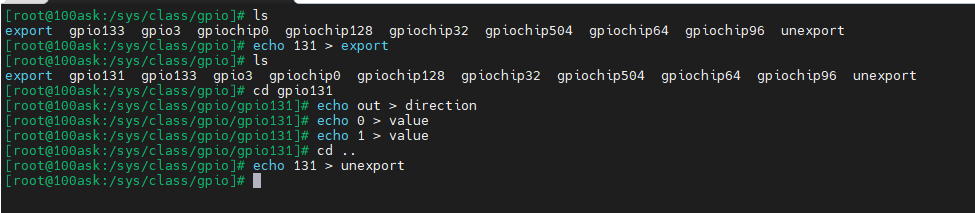

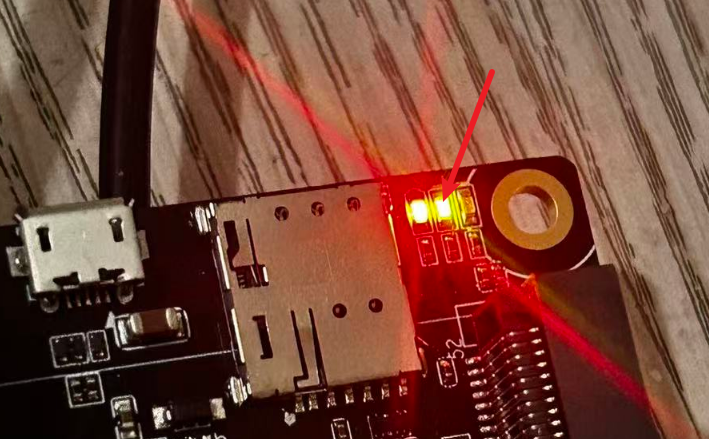

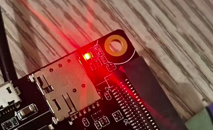

**坑点提醒**：

- 如果 `echo 131 > export` 报错 `Device or resource busy`，说明这个引脚被其他驱动占用了（比如系统自带驱动）。
- 重启后，GPIO状态会复位，需要重新导出。

### 方式二：LED 子系统（设备树配置 + sysfs）

```C
   硬件                  设备树(.dts)                内核驱动             用户可见
┌─────────┐   ┌──────────────────────┐   ┌────────────────┐   ┌──────────────────────┐
│ GPIO5_3 │──▶│ leds { user_led {...}}│──▶│ leds-gpio.c    │──▶│ /sys/class/leds/      │
│ 接一颗灯 │   │ compatible="gpio-leds"│   │ 注册成LED设备    │   │  user_led/           │
└─────────┘   └──────────────────────┘   └────────────────┘   │   ├ brightness       │
                                                              │   ├ trigger          │
                                                              │   └ delay_on/off     │
                                                              └──────────────────────┘

```

一句话：**设备树告诉内核 “这块板子上有颗灯、接在哪个脚、什么极性”；内核驱动把它变成一个标准 LED 设备；然后你只写文件就行，连寄存器都不用碰。**

把“手动点灯”升级成由内核托管灯的亮灭

之前 `ls /sys/class/leds/` 只看到了 `mmc0::`，这是因为内核不知道板子上有个LED连在GPIO5_3上。我们需要在设备树里告诉它。

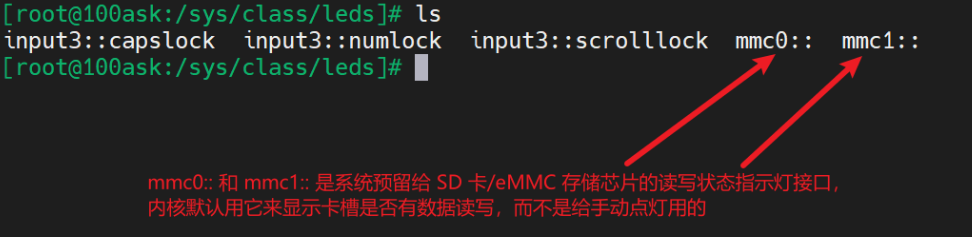

设备树（DTS）是什么：一个硬件说明书

| 问题               | 答案                                                         |
| :----------------- | :----------------------------------------------------------- |
| 为什么要它？       | 一个 ARM 内核镜像要能启动几百种开发板，板级信息不能写死在 C 代码里（以前是 `arch/arm/mach-xxx/board-xxx.c` 一大堆） |
| 它是什么？         | 一份纯文本的硬件描述文件，节点树结构，每个节点描述一个设备   |
| 怎么用？           | `.dts`（板级） + `.dtsi`（SoC 公共部分，被 include） → `dtc` 编译 → `.dtb` 二进制 → 由 uboot 加载后传给内核 |
| 内核拿到后干什么？ | 把每个节点变成 `device`，再拿节点的 `compatible` 字符串去和驱动的 `of_match_table` 做**字符串匹配**，匹配上就 probe |

**1. 修改设备树（DTS文件）**

改之前先备份一下，防止万一改错了一个标点符号，板子可能就开不了机了

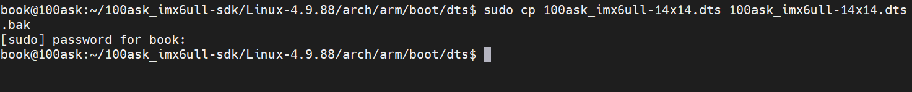

打开 `100ask_imx6ull-14x14.dts`，在根节点下添加：

```C
/ {										// 这个是根节点，不用动
    leds {                                  // 节点名，随便起，只是内核在解析的时候看到这个就知道里面装的全是LED设备，不影响功能
        compatible = "gpio-leds";           // 相亲条件：必须精确等于这个字符串
                                            // 对应驱动 drivers/leds/leds-gpio.c
        								// Linux 内核启动时，会拿着这个字符串去驱动库里找匹配的驱动。
        							// gpio-leds 对应的是内核源码里自带的 drivers/leds/leds-gpio.c 驱动。只要匹配上了，内核就会自动接管这颗灯

        user_led {                          // 子节点，一个真实的设备子节点 = 代表板子上的一颗具体的灯
            label = "user_led";             // ★ sysfs 里的目录名就是它！
                                            // 不写的话会自动拼成 "设备名:颜色:功能"
                                            // 就会看到那种 "xxx::" 的怪名字,如上面查看到的mmc0::这种

            gpios = <&gpio5 3 GPIO_ACTIVE_LOW>;  // 三要素：哪个控制器、第几号脚、极性
                                                 // &gpio5 是 phandle，指向 SoC dtsi 里的，告诉内核，这颗灯接在哪个 GPIO 控制器上（& 符号代表引用，指向底层 dtsi 里定义的第 5 组 GPIO 控制器）
                                                 // gpio5 控制器节点
                                                 // 3 就是 GPIO5_IO03，代表组内的第 3 号引脚（也就是我们之前查原理图确认的 GPIO5_3）
            								 // GPIO_ACTIVE_LOW：这是极性设置（低电平有效），因为硬件是GPIO在负极，输出0亮，加上这个词后，内核底层的驱动会自动帮你把逻辑反转过来，也就是在sysfs里“echo 1 > brightness"，驱动底层会自动向引脚输出0（低电平）从而把灯点亮

            linux,default-trigger = "none"; // 开机默认用哪个触发器，"none"=不自动，纯手动
                                            // 想让开机就闪心跳，把none改成 "heartbeat"，这就叫触发器

            default-state = "off";          // 开机默认亮还是灭：on（开机亮） / off（开机灭） / keep(保持uboot启动时的状态)
            // status = "okay";             // 默认就是okay，一般不写
        };
    };
```

（`GPIO_ACTIVE_LOW` 是个宏，在内核中定义，表示极性反转。）

**2. 重新编译设备树**

切换到book@100ask:~/100ask_imx6ull-sdk/Linux-4.9.88$此目录下指向下列命令

```shell
make dtbs # 指示系统调用编译器，把你修改过的 .dts（设备树源码）编译打包成开发板能认的 .dtb（二进制设备树）文件。
```

因为 `make` 必须在包含**总规则（Makefile）**的**源码根目录**才能正确运行。它需要依靠顶层的环境变量和配置来指挥全局，再一层层把命令传递给底层的 `dts` 目录去编译。在子目录里直接 `make` 会找不到必要的配置而报错。


把生成的 `.dtb` 文件（路径：~/100ask_imx6ull-sdk/Linux-4.9.88/arch/arm/boot/dts/100ask_imx6ull-14x14.dtb）拷贝到开发板的 `/boot` 目录（不同板子路径可能不同，需看具体手册）


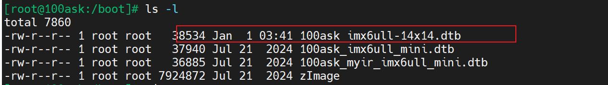

**3. 重启板子后操作**

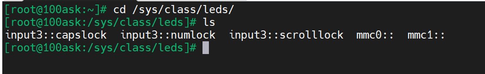

发现并没有找到刚才我们创建的user_led，看一下原来的设备树发现，写了两个 `leds { ... }` 节点

第 18 行：你自己加的 `leds { ... }`，里面是 `user_led`。

第 113 行：**原厂代码里本来就有一个 `leds { ... }`**，里面有个叫 `cpu` 的灯（也用了 GPIO5_3），并且它的 `status = "disabled";`（被禁用了）。

所以不用自己创建了，直接把上面的删除了，然后将原来这里有个 status = "disabled"; 把它删掉或者改成 okay


继续执行make dtbs和scp命令传到开发板中，然后重启开发板查看

注意他的命名是cpu

`/sys/class/leds/cpu/` 里每个文件是什么

| 文件             | 权限 | 读出来是啥                           | 写进去干啥      | 坑                                                   |
| :--------------- | :--- | :----------------------------------- | :-------------- | :--------------------------------------------------- |
| `brightness`     | rw   | 当前亮度，0~max                      | 写 0/1 控制亮灭 | 触发器在跑时写它会被立刻覆盖，先 `echo none`         |
| `max_brightness` | r    | 最大值，**GPIO LED 恒为 1**          | 不可写          | 所以它是 “开关灯”，不是 “调光灯”。想要呼吸灯得上 PWM |
| `trigger`        | rw   | 支持的触发器列表，`[xxx]` 是当前用的 | 写名字切换      | 名字写错会返回 Invalid argument                      |
| `delay_on`       | rw   | 亮多久（毫秒）                       | 写数字          | 只在 timer 触发器下有意义                            |
| `delay_off`      | rw   | 灭多久（毫秒）                       | 写数字          | 同上                                                 |
| `uevent`         | r    | 设备信息                             | —               | udev 用的，别管                                      |


可以发现，这里输入1是亮，0是灭：因为用的接口不同

**裸 GPIO 接口（`/sys/class/gpio/`）**：直连硬件。你写 `0`，硬件就输出低电平，灯亮（底层没有翻译）。

**LED 子系统（`/sys/class/leds/`）**：有内核驱动。设备树里的 `GPIO_ACTIVE_LOW` 让驱动帮你做了**逻辑反转**。

```C
  你的操作(逻辑层)          LED子系统             gpiolib            物理引脚       灯
 ─────────────────────────────────────────────────────────────────────────────────
  echo 1 > brightness  →  brightness=1  →  gpiod_set_value(1)  →  输出低电平 0  →  亮 🔆
  echo 0 > brightness  →  brightness=0  →  gpiod_set_value(0)  →  输出高电平 1  →  灭 ⚫
                                            ↑
                                    这里根据 flag 做了取反
```

如果把触发器改成心跳模式的话，LED会有闪烁的效果

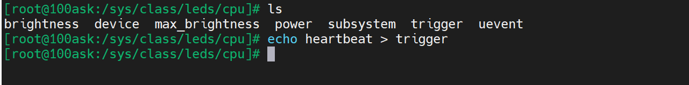

把触发器设置计时模式，按照设置的时间闪烁


**注意：如果把状态设置成okay之后，上一个直接通过GPIO操作灯亮灭的情况就不适用了，因为资源被占用了， 会报错：-bash: echo: write error: Device or resource busy。**

当设备树里的 `status = "okay";` 生效后，LED 驱动在开机时就会把这个引脚（GPIO5_3）**死死占住**。

此时你再去 `/sys/class/gpio` 里执行 `echo 131 > export`，系统就会报 `Device or resource busy`（设备忙），因为你不能跟内核驱动抢同一个引脚。


### 方式三：libgpiod 工具（现代标准方案）

**前提**：把方式二里设备树中的 `leds { ... }` 节点状态改回 `disabled`，重新编译 `dtb` 并重启，确保引脚未被其他驱动占用。

**sysfs 这种老接口在 Linux 4.8 之后被认为是过时的，新版内核逐渐使用 `libgpiod`。它通过 `/dev/gpiochipN` 字符设备操作。**

#### 为什么我们需要 libgpiod？

**libgpiod 出来是解决什么问题的？**

`/sys/class/gpio` 那套（`echo 131 > export`）在 Linux 4.8 之后被标为 deprecated，原因是它有一堆硬伤：

| sysfs gpio 的问题                    | 具体表现                                                     |
| :----------------------------------- | :----------------------------------------------------------- |
| **要用全局编号**                     | GPIO5_3 要算成 `base(128) + 3 = 131`，base 随内核变，换个板子编号就变 |
| **没有所有权**                       | A 进程设成输出，B 进程毫不知情地又改，互相踩                 |
| **多引脚不原子**                     | 想同时翻转两个脚，只能一个一个 echo，中间有时间缝隙（竞态）  |
| **没有事件支持**                     | 中断 / 边沿检测基本不可用                                    |
| **一次操作要 open/write/close 多次** | 频繁点灯时开销大                                             |

#### 懂 libgpiod 之前必须跨过的三道门

**第 1 层：硬件 —— 为什么这颗灯是 “低电平亮”**

GPIO 是**General Purpose Input/Output**，通用输入输出。一个引脚可以扮演三种角色：

| 角色                 | 干什么                            | 例子           |
| :------------------- | :-------------------------------- | :------------- |
| 输出（output）       | 我决定它是高还是低                | 点灯、拉继电器 |
| 输入（input）        | 我读它是高还是低                  | 按键、传感器   |
| 复用（alt function） | 它不当 GPIO 了，去当 UART/I2C/PWM | 串口、屏幕背光 |

**同一个物理引脚，同一时刻只能被其中一个角色使用。** 这是理解后面所有内容的基石。

为什么 0 = 亮

这颗 LED 的电路是这么接的：

```c
      VCC (3.3V)
         │
        ┌┴┐  限流电阻
        │ │
        └┬┘
         │
        ─┴─  LED（三角形是阳极，横线是阴极）
         │
         ▼
     GPIO5_3  ──── 拉低(0) → 有电流通路 → 亮 🔆
                   拉高(1) → 两端都是 3.3V → 没电流 → 灭 ⚫

```

**结论：这颗灯的 “物理语义” 天生是反的 —— 0 才亮。**

> 记下这句话，后面每次看到 “1 是亮还是灭” 的疑惑，都回来对一遍：
>
> - **物理层**：0 = 亮
> - **leds 子系统层**：1 = 亮（因为设备树里写了 `GPIO_ACTIVE_LOW`，内核帮忙翻转了）
> - **libgpiod 层**：0 = 亮（直接写物理电平，不翻转）

**第 2 层：名字 —— `GPIO5_3` 这一个脚有五套叫法**

初学者最晕的就是这个。同一个引脚，在不同地方叫不同名字：

| 场合                  | 叫法                                 | 怎么读                                   |
| :-------------------- | :----------------------------------- | :--------------------------------------- |
| **数据手册**          | `GPIO5_IO03`                         | 第 5 组 GPIO 控制器的第 3 号             |
| **芯片引脚名**        | `SNVS_TAMPER3`                       | 这个 pad 的物理名（i.MX6ULL 特有）       |
| **设备树宏**          | `MX6UL_PAD_SNVS_TAMPER3__GPIO5_IO03` | 双下划线左边 = 物理 pad，右边 = 目标功能 |
| **设备树 gpios 属性** | `<&gpio5 3>`                         | 控制器 + 偏移号                          |
| **内核全局编号**      | `131`                                | 给老 sysfs 用的，`(5-1)*32 + 3`          |
| **libgpiod**          | `gpiochip4` 的 `line 3`              | 芯片 + 偏移号                            |

三层结构图

```c
  SoC(整颗芯片)内部集成了5个GPIO控制器
   ├── GPIO1 控制器（32个脚）→ 全局号 0~31   → gpiochip0
   ├── GPIO2 控制器（32个脚）→ 全局号 32~63  → gpiochip1
   ├── GPIO3 控制器（32个脚）→ 全局号 64~95  → gpiochip2
   ├── GPIO4 控制器（32个脚）→ 全局号 96~127 → gpiochip3
   └── GPIO5 控制器（32个脚）→ 全局号 128~159 → gpiochip4   ★ 你的灯在这
           └── 第 3 号脚 = GPIO5_IO03 = 全局 131 = gpiochip4 的 line 3
```

顺带一个硬核小知识

`MX6UL_PAD_SNVS_TAMPER3__GPIO5_IO03` 这个宏，本质是往 IOMUXC 寄存器写一个值：**把 MUX_MODE 设成 5（ALT5=GPIO）**。i.MX6 系列里 GPIO 功能固定在 ALT5。所以你在设备树里看到这个宏，心里翻译成一句人话：“**把这个 pad 切成 GPIO 模式**”。

**第 3 层：所有权 —— 一个引脚只能有一个 “主人”**

一个引脚从 “芯片上的金属块” 变成 “能被操作的东西”，要过两道设置：

```c
   物理 pad
      │
      ├─①  pinmux（IOMUXC 寄存器）：决定它是 GPIO 还是一根串口线
      │       由 pinctrl 子系统管，设备树里 pinctrl-0 指定的那组
      │
      └─②  所有权（gpiolib）：被某个"消费者(consumer)"申请走
              由 gpiod_get() / gpiod_request() 完成
              谁申请走，别人就拿不到，会返回 EBUSY
```

谁能当主人

| 主人                         | 怎么申请的                                     | 你在哪能看到                       |
| :--------------------------- | :--------------------------------------------- | :--------------------------------- |
| `gpio-leds` 驱动             | 设备树 `leds` 节点 → 驱动 probe 时 `gpiod_get` | `gpioinfo` 里 consumer 写 `"leds"` |
| `gpio-keys` 驱动（按键）     | 设备树 `gpio-keys` 节点                        | `"gpio-keys"`                      |
| 某个内核驱动（网卡复位脚等） | 各驱动自己申请                                 | 驱动名字                           |
| **你的用户态程序**           | `gpiod_line_request_*` / `echo N > export`     | 你传的 consumer 名字               |

撞墙的完整因果链

```C
把 leds 节点 status 改成 okay
        ↓
gpio-leds 驱动 probe → gpiod_get(GPIO5_3) → 占住
        ↓
现在用 libgpiod 去 gpiod_line_request_output(GPIO5_3)
        ↓
返回 -1，errno = EBUSY "Device or resource busy"
        ↓
你以为是命令写错了，其实是"这个脚已经有主人了"
```

**一句面试金句：Linux 里 GPIO 是 “资源”，不是 “变量”。申请不到就是申请不到，不会排队、不会抢占。**

怎么一眼看出主人是谁

```shell
cat /sys/kernel/debug/gpio # 可以查看当前 Linux 内核中所有 GPIO 控制器（gpiochip）的状态，以及已经被申请（占用）的 GPIO 引脚。
```

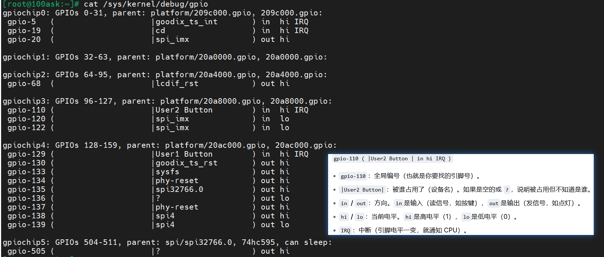

内核里只有**一个老板**在真正操作寄存器，叫 `gpiolib`。它对外开了三个窗口，供不同时代、不同需求的程序使用：

```c
                        ┌──────────────────────────────┐
                        │        内核 gpiolib           │
                        │  gpiod_request / gpiod_set    │
                        └───────────┬──────────────────┘
            ┌───────────────────────┼──────────────────────────┐
            │                       │                          │
   窗口①  /sys/class/gpio     窗口② /sys/class/leds      窗口③ /dev/gpiochipN
   （2008 年）                （2008 年，内核驱动内部用）    （2016 年 4.8 起）
   export / direction / value   brightness / trigger        ioctl
   已 deprecated ⚠️             工程首选 ✅                 现代标准 ✅
```

**以现在的板子状况是：**

- ① sysfs 能用，但老了，别写进项目
- ② leds 完美可用，已经实现了
- ③ libgpiod **只能用 1.x 版本**，2.x 装的库在上面跑会 `ENOTTY`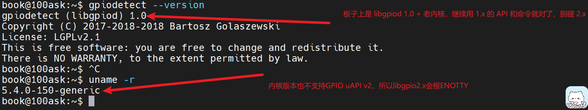

#### libgpiod 是什么 —— 一个库 + 一堆工具

很多人以为 libgpiod 是个 “命令”，其实它是**两样东西**：

- **库（`.so` 文件）**：C 语言程序用它
- **工具集（`gpiodetect` 等）**：给人临时敲命令测试用的

```C
libgpiod（一个开源项目）
 ├── libgpiod.so      ← C 语言库，你的程序链接它
 └── gpiod 工具集      ← 命令行程序，给你临时验证硬件用的
      ├── gpiodetect   我看有哪些 chip
      ├── gpioinfo     看这个 chip 每根线什么状态
      ├── gpioset      设电平（输出）
      ├── gpioget      读电平（输入）
      └── gpiomon      监听电平变化（相当于中断）
```

四个核心概念（一定要分清）

| 概念                   | 含义                                                         | 你的例子里                    |
| :--------------------- | :----------------------------------------------------------- | :---------------------------- |
| **chip（芯片）**       | 一颗 SoC 里的一个 GPIO 控制器（如 `gpiochip4`），对应 `/dev/gpiochipN` 设备文件 | `gpiochip4`（= GPIO5 控制器） |
| **line（线）**         | 芯片上的一根引脚（如 `line 3`）                              | 第 3 号那根                   |
| **offset（偏移）**     | 这根线在芯片内的下标（从 0 开始）                            | `3`                           |
| **consumer（消费者）** | 申请这根线时填写的“名字”（比如填 `"my_led"`），用于在系统里登记归属，出问题了一查就知道是谁占的 | `"led"`                       |

**注意：libgpiod 里没有 “全局编号 131” 这个概念了**，只有 `chip + offset`。这比 sysfs 的 131 好记多了，也是它取代 sysfs 的原因之一。

**⚠️ 踩坑记录：关于编译命令行工具**
起初我试图通过 Buildroot 编译 `gpiodetect` 等工具，但遇到了极大困难：

1. 系统默认编译带了 `--disable-tools` 参数，只生成了库，没生成工具。
2. 手动改 `libgpiod.mk` 删掉该参数并 `make libgpiod-dirclean` 后重新编译，依然没生成。
3. 手动进入源码目录 `./configure` 交叉编译时，遇到了 `undefined reference to 'rpl_malloc'` 的经典报错。

**结论**：作为开发者，没必要死磕命令行工具。在实际项目中，直接写 C 语言代码才是正道。

一次完整的 “借还” 流程

```C
① gpiod_chip_open("/dev/gpiochip4")     打开仓库
        ↓
② gpiod_chip_get_line(chip, 3)          找到第 3 号货位
        ↓
③ gpiod_line_request_output(line,       登记认领：名字"led"，方向输出，初始高电平
                            "led", 1)    ★ 这一步成功 = 拿到所有权
        ↓
④ gpiod_line_set_value(line, 0)         开始干活：拉低 → 亮
        ↓
⑤ gpiod_line_release(line)              放手
        ↓
⑥ gpiod_chip_close(chip)                关仓库
```

**③ 是唯一会失败在 EBUSY 的一步。** 所有的 “点不亮”，90% 卡在 ③。

#### 核心实操：编写 C 语言程序点亮 LED

```c
#include <stdio.h>
// libgpiod库的主头文件，它不是标准C库头文件（不是glibc自带的），也不是内核文件
// 是用户空间库libgpio对外暴露的API声明，专门用来操作Linux /dev/gpiochip*字符设备（新版GPIO子系统）
// 里面放了啥？
// 结构体声明：struct gpiod_chip/struct gpiod_line(V1版本)
// 就是下面调用的函数，如gpiod_chip_open，gpiod_chip_get_line和gpiod_line_release等
#include <gpiod.h>
#include <unistd.h>

int main(){

        // 1.打开gpio芯片（仓库）
        // "/dev/gpiochip4"：内核生成的字符设备文件，代表一个 GPIO 控制器（gpiochip）
        // gpiod_chip_open函数就是打开这个控制器，范围结构体句柄，后续拿这个句柄取引脚
        // chip就是这个GPIO控制器仓库的指针
        struct gpiod_chip *chip = gpiod_chip_open("/dev/gpiochip4");
        if(!chip){
                perror("打开gpiochip4失败");
                return -1;
        }
        printf("①打开/dev/gpiochip4成功\n");

        // 2.获取第3号line位（货位）
        // chip：已经打开的gpiochip仓库句柄
        // gpiod_chip_get_line(chip, 3)：在这个芯片内部，拿到第 3 号 line 的引用（货位 3）
        // 返回值 struct gpiod_line *line：就是这条引脚的引用指针
        struct gpiod_line *line = gpiod_chip_get_line(chip,3);
        if(!line){
                perror("获取line3失败");
                gpiod_chip_close(chip);
                return -1;
        }
        printf("②获取line3成功\n");

        // 第二步只是拿到引用，还没有独占，还不能控制电平
        // 内核此时并没有把引脚分配给程序，别的程序照样可以申请这条line,真正抢所有权的是第三步
        // 3.申请为输出，标签为“led”,初始电平为1（高）
        // line:前面拿到的line引用
        // led:给这条占用打一个名字标签，用gpioinfo命令可以看到是谁占用了，方便调试
        // 申请失败的情况：这条line已经被别的驱动/程序占用，权限不足，line本身不存在等
        int ret = gpiod_line_request_output(line,"led",1);
        if(ret < 0){
                perror("申请line输出失败");
                gpiod_chip_close(chip);
                return -1;
        }
        printf("③申请line输出所有权成功，初始高电平\n");

        while(1){
                // 4.修改已经申请好的输出引脚电平,设置电平为0，拉低，点亮LED
                // line:已通过gpiod_line_request_output申领成功的引脚
                // 0 --- >   低电平   1   ---> 高电平
                // 失败的情况：这条line根本没有request成功，已经被释放，内核异常等
                // 这里是规范兜底，出错的时候，先释放line，再关闭chip，防止资源泄露
                ret = gpiod_line_set_value(line,0);
                if(ret < 0){
                        perror("设置低电平失败");
                        gpiod_line_release(line);
                        gpiod_chip_close(chip);
                        return -1;
                }
                printf("④输出0，LED灯点亮\n");

                // 保持2秒亮
                sleep(2);

                // 在设置1熄灭
                gpiod_line_set_value(line,1);
                printf("        输出 1，LED熄灭\n");

                // 保持2秒灭
                sleep(2);

        }

        // 5.释放line
        gpiod_line_release(line);
        printf("⑤释放line\n");

        // 6.关闭芯片
        gpiod_chip_close(chip);
        printf("⑥关闭chip,流程结束\n");

        return 0;
}

```

编译运行一下

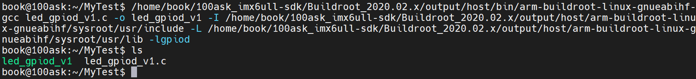

有点长，因为它把**“用哪个编译器”**、**“编译哪个文件”**、**“去哪里找头文件”**、**“去哪里找库文件”**全部写在一行里了。因为你是**交叉编译**（在电脑上给开发板造程序），系统默认不知道工具在哪，必须把所有的“家底”都交代清楚

解释一下

**`/home/book/.../arm-buildroot-linux-gnueabihf-gcc`**
👉 **用哪个编译器**。咱们不用电脑自带的 `gcc`，而是用百问网 Buildroot 里专门给 ARM 开发板用的交叉编译器。

**`led_gpiod_v1.c -o led_gpiod_v1`**
👉 **输入和输出**。把 `led_gpiod_v1.c` 这个源码，编译成名叫 `led_gpiod_v1` 的执行程序。

**`-I /home/book/.../sysroot/usr/include`**
👉 **去哪找头文件**（大写 `I`）。你的代码里有 `#include <gpiod.h>`，电脑系统里默认没有这个文件，我们必须告诉编译器去 Buildroot 的目录里找。

**`-L /home/book/.../sysroot/usr/lib`**
👉 **去哪找库文件**（大写 `L`）。告诉编译器，链接的时候去这个目录下找库。

**`-lgpiod`**
👉 **链接哪个库**（小写 `l`）。告诉编译器，去刚才那个目录里，把名为 `libgpiod.so` 的库连上。

为了后续方便，直接写个MakeFile

```makefile

# ==========================================
# 指定交叉编译器 (CC)
# 这是 Buildroot 编译出来的专门给 ARM 开发板用的编译器
# ==========================================
CC = arm-buildroot-linux-gnueabihf-gcc

# ==========================================
# 定义变量 SYSROOT，指向交叉编译器的系统根目录
# 这是整个 Makefile 最核心的变量！
# 它包含了开发板需要的基本头文件、库文件等（相当于一个小型的根文件系统）
# ==========================================
SYSROOT := /home/book/100ask_imx6ull-sdk/Buildroot_2020.02.x/output/host/arm-buildroot-linux-gnueabihf/sysroot

# ==========================================
# 编译参数 (CFLAGS)
# --sysroot 告诉编译器：在这个目录下找头文件
# 这样就能自动找到 gpiod.h 等第三方头文件，不用手动写 -I
# += 表示追加
# ==========================================
CFLAGS  += --sysroot=$(SYSROOT)

# ==========================================
# 链接参数 (LDFLAGS)
# --sysroot 告诉链接器：在这个目录下找库文件
# 这样就能自动找到 libgpiod.so 等库，不用手动写 -L
# ==========================================
LDFLAGS += --sysroot=$(SYSROOT)

# ==========================================
# 库链接参数 (LDLIBS)
# -lgpiod 告诉链接器：把 libgpiod.so 这个库连上
# 注意：-l 后面跟的是库名，不用写 lib 前缀和 .so 后缀
# ==========================================
LDLIBS  += -lgpiod

# ==========================================
# 目标规则 (Target)
# 语法：目标文件 : 依赖文件
# 意思是：要把 led_gpiod_v1.c 编译成 led_gpiod_v1
# ==========================================
led_gpiod_v1: led_gpiod_v1.c
# ==========================================
# 实际执行的编译命令
# $(CC)      -> 展开成交叉编译器
# $^         -> 代表所有依赖文件 (也就是 led_gpiod_v1.c)
# -o $@      -> $@ 代表目标文件 (也就是 led_gpiod_v1)，-o 指定输出名字
# $(CFLAGS)  -> 展开成 --sysroot=...
# $(LDFLAGS) -> 展开成 --sysroot=...
# $(LDLIBS)  -> 展开成 -lgpiod
# 注意：这行命令的最前面必须是一个 Tab 键，不能用空格！
# ==========================================
        $(CC) $^ -o $@ $(CFLAGS) $(LDFLAGS) $(LDLIBS)

# ==========================================
# 清理规则 (Clean)
# 敲 make clean 会执行下面的命令，删除生成的可执行文件
# 方便重新编译时从头开始
# ==========================================
clean:
        rm -f led_gpiod_v1
```

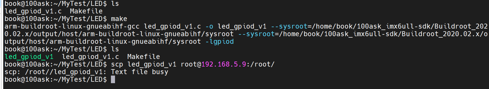

上传到包子的根目录下后运行即可实现定时灯的效果了

2. 方式四（写字符设备驱动）的前提：

- **绝对不能有冲突**：在 Linux 里，一个 GPIO 只能由一个驱动管理。如果你自己写了一个驱动去请求 GPIO5_3，而设备树里的 `gpio-leds` 已经占用了它，你的驱动 `probe` 函数就会直接失败返回（比如报 `-EBUSY` 错误）。
- **前提条件**：同样需要先把原本的 `leds` 节点禁用掉，腾出引脚，然后**自己写一个字符设备驱动**，在代码里通过 `gpio_request` 或者 `gpiod_get` 去接管这个引脚。
