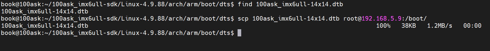
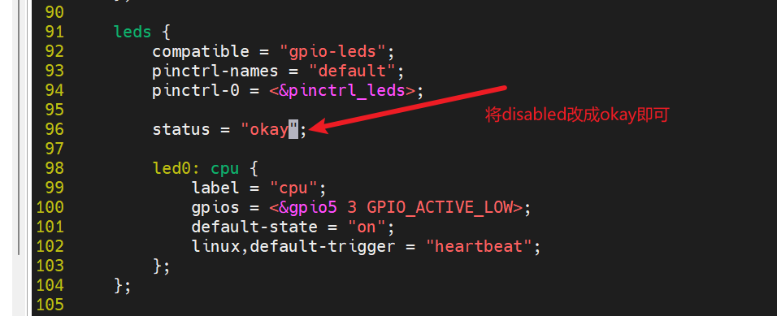
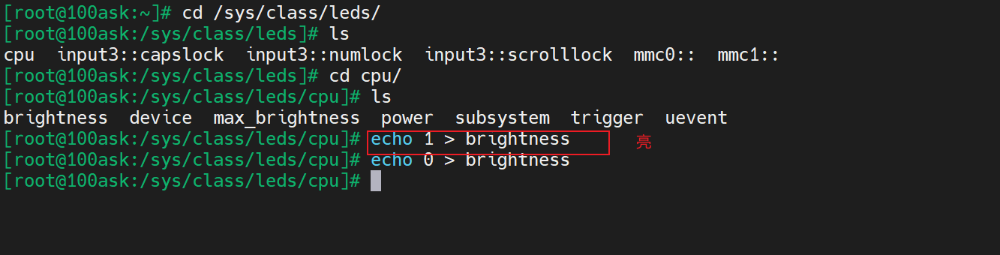
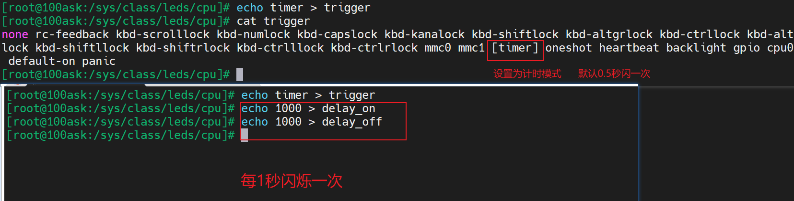

# 从零开始点亮一颗 LED

## 1.原理图


各个元件含义

1. **VDD_3V3**：3.3V 电源。
2. **R50：1KΩ 电阻**：限流电阻，防止 LED 电流过大烧毁；标注 `/4/1%` 代表功率 1/4 W、精度 1%。
3. **LED2（LED-0603）**：0603 贴片发光二极管，阳极接电阻、阴极接到 GPIO。
4. GPIO5_3 / SNVS_TAMPER3：同一个引脚的两个名字：
   - `SNVS_TAMPER3`：引脚原始功能，属于 SNVS 域，本来是安全防拆（Tamper）检测输入；
   - 软件配置复用后，就是 `GPIO5_IO03`，普通通用 IO 口，用来驱动 LED

### 亮灭逻辑

- **GPIO 输出低电平（0V）**：3.3V → 电阻 → LED 阳极 → LED 阴极 → GPIO 到地，有电流流过 → **灯亮**。
- **GPIO 输出高电平（3.3V）**：LED 两端电压差不多相等，没有压差，几乎无电流 → **灯灭**。

## 2.点灯前必须懂的基础概念

### 2.1 什么是GPIO？

GPIO（General Purpose Input/Output）是芯片上的“通用引脚”，可以被软件配置为：

- **输出模式（Output）**：控制引脚输出高电平（通常3.3V）或低电平（0V）。点灯就是这种模式。
- **输入模式（Input）**：读取外部信号（比如按键按没按下）。

### 2.2 高电平有效 vs 低电平有效（重点！）

初学者最容易在这里迷糊。在原理图上，LED有两种接法：

- **高电平有效（Active High）**：LED正极接GPIO，负极接地（GND）。GPIO输出 **1** 亮，**0** 灭。
- **低电平有效（Active Low）**：LED正极接电源（VDD_3V3），负极接GPIO。GPIO输出 **0** 亮，**1** 灭。

**此板子（GPIO5_3）就是低电平有效！** 原理图是：`VDD_3V3` → 电阻 → LED → `GPIO5_3`。所以输出0时，电流流向GPIO（如同接地），灯亮。

### 2.3 为什么不能直接把GPIO接电源和地？

如果不接限流电阻，直接接3.3V和GND，LED会瞬间烧毁（或烧毁GPIO引脚）。

原理图上的 `R50（1K欧姆）` 就是用来限制电流的。

### 2.4 i.MX6ULL的引脚命名与编号计算

在手册上，引脚叫 `GPIO5_IO03`（组5，第3个引脚）。但在Linux的sysfs里，我们要用**全局编号**：

> **计算公式**：`全局编号 = (组号 - 1) * 32 + 引脚号`
> **计算 GPIO5_3**：`(5 - 1) * 32 + 3 = 131`
> （以此类推，GPIO1_IO05 就是 (1-1)*32+5 = 5）

## 3.五种点灯方式（从简单到底层）

### 方式一：sysfs 直接操作 GPIO（你实操过的）

**原理**：Linux内核把GPIO抽象成了文件（一切皆文件的思想），通过“写文件”控制硬件。

**完整命令**：

```shell
# 1. 进入gpio目录
cd /sys/class/gpio

# 2. 导出引脚131（告诉内核：我要控制这个引脚）
echo 131 > export

# 3. 进入具体引脚的目录
cd gpio131

# 4. 设置方向为输出
echo out > direction

# 5. 点亮（输出低电平0）
echo 0 > value

# 6. 熄灭（输出高电平1）
echo 1 > value

# 7. 释放引脚（不使用了，要释放掉）
cd ..
echo 131 > unexport
```


**坑点提醒**：

- 如果 `echo 131 > export` 报错 `Device or resource busy`，说明这个引脚被其他驱动占用了（比如系统自带驱动）。
- 重启后，GPIO状态会复位，需要重新导出。

### 方式二：LED 子系统（设备树配置 + sysfs）

把“手动点灯”升级成由内核托管灯的亮灭

之前 `ls /sys/class/leds/` 只看到了 `mmc0::`，这是因为内核不知道板子上有个LED连在GPIO5_3上。我们需要在设备树里告诉它。


设备树（DTS）是什么：一个硬件说明书

| 问题               | 答案                                                         |
| :----------------- | :----------------------------------------------------------- |
| 为什么要它？       | 一个 ARM 内核镜像要能启动几百种开发板，板级信息不能写死在 C 代码里（以前是 `arch/arm/mach-xxx/board-xxx.c` 一大堆） |
| 它是什么？         | 一份纯文本的硬件描述文件，节点树结构，每个节点描述一个设备   |
| 怎么用？           | `.dts`（板级） + `.dtsi`（SoC 公共部分，被 include） → `dtc` 编译 → `.dtb` 二进制 → 由 uboot 加载后传给内核 |
| 内核拿到后干什么？ | 把每个节点变成 `device`，再拿节点的 `compatible` 字符串去和驱动的 `of_match_table` 做**字符串匹配**，匹配上就 probe |

**1. 修改设备树（DTS文件）**

改之前先备份一下，防止万一改错了一个标点符号，板子可能就开不了机了


打开 `100ask_imx6ull-14x14.dts`，在根节点下添加：

```C
/ {										// 这个是根节点，不用动
    leds {                                  // 节点名，随便起，只是内核在解析的时候看到这个就知道里面装的全是LED设备，不影响功能
        compatible = "gpio-leds";           // 相亲条件：必须精确等于这个字符串
                                            // 对应驱动 drivers/leds/leds-gpio.c
        								// Linux 内核启动时，会拿着这个字符串去驱动库里找匹配的驱动。
        							// gpio-leds 对应的是内核源码里自带的 drivers/leds/leds-gpio.c 驱动。只要匹配上了，内核就会自动接管这颗灯

        user_led {                          // 子节点，一个真实的设备子节点 = 代表板子上的一颗具体的灯
            label = "user_led";             // ★ sysfs 里的目录名就是它！
                                            // 不写的话会自动拼成 "设备名:颜色:功能"
                                            // 就会看到那种 "xxx::" 的怪名字,如上面查看到的mmc0::这种

            gpios = <&gpio5 3 GPIO_ACTIVE_LOW>;  // 三要素：哪个控制器、第几号脚、极性
                                                 // &gpio5 是 phandle，指向 SoC dtsi 里的，告诉内核，这颗灯接在哪个 GPIO 控制器上（& 符号代表引用，指向底层 dtsi 里定义的第 5 组 GPIO 控制器）
                                                 // gpio5 控制器节点
                                                 // 3 就是 GPIO5_IO03，代表组内的第 3 号引脚（也就是我们之前查原理图确认的 GPIO5_3）
            								 // GPIO_ACTIVE_LOW：这是极性设置（低电平有效），因为硬件是GPIO在负极，输出0亮，加上这个词后，内核底层的驱动会自动帮你把逻辑反转过来，也就是在sysfs里“echo 1 > brightness"，驱动底层会自动向引脚输出0（低电平）从而把灯点亮

            linux,default-trigger = "none"; // 开机默认用哪个触发器，"none"=不自动，纯手动
                                            // 想让开机就闪心跳，把none改成 "heartbeat"，这就叫触发器

            default-state = "off";          // 开机默认亮还是灭：on（开机亮） / off（开机灭） / keep(保持uboot启动时的状态)
            // status = "okay";             // 默认就是okay，一般不写
        };
    };
```

（`GPIO_ACTIVE_LOW` 是个宏，在内核中定义，表示极性反转。）

**2. 重新编译设备树**

切换到book@100ask:~/100ask_imx6ull-sdk/Linux-4.9.88$此目录下指向下列命令

```shell
make dtbs # 指示系统调用编译器，把你修改过的 .dts（设备树源码）编译打包成开发板能认的 .dtb（二进制设备树）文件。
```

因为 `make` 必须在包含**总规则（Makefile）**的**源码根目录**才能正确运行。它需要依靠顶层的环境变量和配置来指挥全局，再一层层把命令传递给底层的 `dts` 目录去编译。在子目录里直接 `make` 会找不到必要的配置而报错。


把生成的 `.dtb` 文件（路径：~/100ask_imx6ull-sdk/Linux-4.9.88/arch/arm/boot/dts/100ask_imx6ull-14x14.dtb）拷贝到开发板的 `/boot` 目录（不同板子路径可能不同，需看具体手册）




**3. 重启板子后操作**


发现并没有找到刚才我们创建的user_led，看一下原来的设备树发现，写了两个 `leds { ... }` 节点

第 18 行：你自己加的 `leds { ... }`，里面是 `user_led`。

第 113 行：**原厂代码里本来就有一个 `leds { ... }`**，里面有个叫 `cpu` 的灯（也用了 GPIO5_3），并且它的 `status = "disabled";`（被禁用了）。

所以不用自己创建了，直接把上面的删除了，然后将原来这里有个 status = "disabled"; 把它删掉或者改成 okay



继续执行make dtbs和scp命令传到开发板中，然后重启开发板查看

注意他的命名是cpu



可以发现，这里输入1是亮，0是灭：因为用的接口不同

**裸 GPIO 接口（`/sys/class/gpio/`）**：直连硬件。你写 `0`，硬件就输出低电平，灯亮（底层没有翻译）。

**LED 子系统（`/sys/class/leds/`）**：有内核驱动。设备树里的 `GPIO_ACTIVE_LOW` 让驱动帮你做了**逻辑反转**。

如果把触发器改成心跳模式的话，LED会有闪烁的效果


把触发器设置计时模式，按照设置的时间闪烁



**注意：如果把状态设置成okay之后，上一个直接通过GPIO操作灯亮灭的情况就不适用了，因为资源被占用了， 会报错：-bash: echo: write error: Device or resource busy。**

当设备树里的 `status = "okay";` 生效后，LED 驱动在开机时就会把这个引脚（GPIO5_3）**死死占住**。

此时你再去 `/sys/class/gpio` 里执行 `echo 131 > export`，系统就会报 `Device or resource busy`（设备忙），因为你不能跟内核驱动抢同一个引脚。

### 方式三：libgpiod 工具（现代标准方案）

这个方式和下面的方式的前提**全都建立在“引脚没有被 LED 子系统（方式二）霸占”的基础上。**因为你现在的设备树已经把引脚交给了 `gpio-leds` 驱动，所以：先把上面方式2所做的操作恢复一下，改回disabled即可


1. 方式三（libgpiod 工具）的前提：

- **引脚必须空闲**：不能被其他内核驱动占用。如果你直接运行 `gpioset gpiochip4 3=0`，系统会报错 `Device or resource busy`（跟之前那个 sysfs 报错一模一样）。
- **前提条件**：必须把设备树里的 `leds { ... }` 节点删掉或设为 `disabled`，重新编译重启后，才能用 `libgpiod` 去申请这个引脚。

2. 方式四（写字符设备驱动）的前提：

- **绝对不能有冲突**：在 Linux 里，一个 GPIO 只能由一个驱动管理。如果你自己写了一个驱动去请求 GPIO5_3，而设备树里的 `gpio-leds` 已经占用了它，你的驱动 `probe` 函数就会直接失败返回（比如报 `-EBUSY` 错误）。
- **前提条件**：同样需要先把原本的 `leds` 节点禁用掉，腾出引脚，然后**自己写一个字符设备驱动**，在代码里通过 `gpio_request` 或者 `gpiod_get` 去接管这个引脚。
