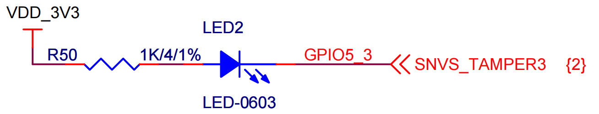

# 从零开始点亮一颗 LED

## 1.原理图



各个元件含义

1. **VDD_3V3**：3.3V 电源。
2. **R50：1KΩ 电阻**：限流电阻，防止 LED 电流过大烧毁；标注 `/4/1%` 代表功率 1/4 W、精度 1%。
3. **LED2（LED-0603）**：0603 贴片发光二极管，阳极接电阻、阴极接到 GPIO。
4. GPIO5_3 / SNVS_TAMPER3：同一个引脚的两个名字：
   - `SNVS_TAMPER3`：引脚原始功能，属于 SNVS 域，本来是安全防拆（Tamper）检测输入；
   - 软件配置复用后，就是 `GPIO5_IO03`，普通通用 IO 口，用来驱动 LED

### 亮灭逻辑

- **GPIO 输出低电平（0V）**：3.3V → 电阻 → LED 阳极 → LED 阴极 → GPIO 到地，有电流流过 → **灯亮**。
- **GPIO 输出高电平（3.3V）**：LED 两端电压差不多相等，没有压差，几乎无电流 → **灯灭**。

## 2.点灯前必须懂的基础概念

### 2.1 什么是GPIO？

GPIO（General Purpose Input/Output）是芯片上的“通用引脚”，可以被软件配置为：

- **输出模式（Output）**：控制引脚输出高电平（通常3.3V）或低电平（0V）。点灯就是这种模式。
- **输入模式（Input）**：读取外部信号（比如按键按没按下）。

### 2.2 高电平有效 vs 低电平有效（重点！）

初学者最容易在这里迷糊。在原理图上，LED有两种接法：

- **高电平有效（Active High）**：LED正极接GPIO，负极接地（GND）。GPIO输出 **1** 亮，**0** 灭。
- **低电平有效（Active Low）**：LED正极接电源（VDD_3V3），负极接GPIO。GPIO输出 **0** 亮，**1** 灭。

**此板子（GPIO5_3）就是低电平有效！** 原理图是：`VDD_3V3` → 电阻 → LED → `GPIO5_3`。所以输出0时，电流流向GPIO（如同接地），灯亮。

### 2.3 为什么不能直接把GPIO接电源和地？

如果不接限流电阻，直接接3.3V和GND，LED会瞬间烧毁（或烧毁GPIO引脚）。

原理图上的 `R50（1K欧姆）` 就是用来限制电流的。

### 2.4 i.MX6ULL的引脚命名与编号计算

在手册上，引脚叫 `GPIO5_IO03`（组5，第3个引脚）。但在Linux的sysfs里，我们要用**全局编号**：

> **计算公式**：`全局编号 = (组号 - 1) * 32 + 引脚号`
> **计算 GPIO5_3**：`(5 - 1) * 32 + 3 = 131`
> （以此类推，GPIO1_IO05 就是 (1-1)*32+5 = 5）

## 3.五种点灯方式（从简单到底层）

### 方式一：sysfs 直接操作 GPIO（你实操过的）

**原理**：Linux内核把GPIO抽象成了文件（一切皆文件的思想），通过“写文件”控制硬件。

**完整命令**：

```shell
# 1. 进入gpio目录
cd /sys/class/gpio

# 2. 导出引脚131（告诉内核：我要控制这个引脚）
echo 131 > export

# 3. 进入具体引脚的目录
cd gpio131

# 4. 设置方向为输出
echo out > direction

# 5. 点亮（输出低电平0）
echo 0 > value

# 6. 熄灭（输出高电平1）
echo 1 > value

# 7. 释放引脚（不使用了，要释放掉）
cd ..
echo 131 > unexport
```


**坑点提醒**：

- 如果 `echo 131 > export` 报错 `Device or resource busy`，说明这个引脚被其他驱动占用了（比如系统自带驱动）。
- 重启后，GPIO状态会复位，需要重新导出。